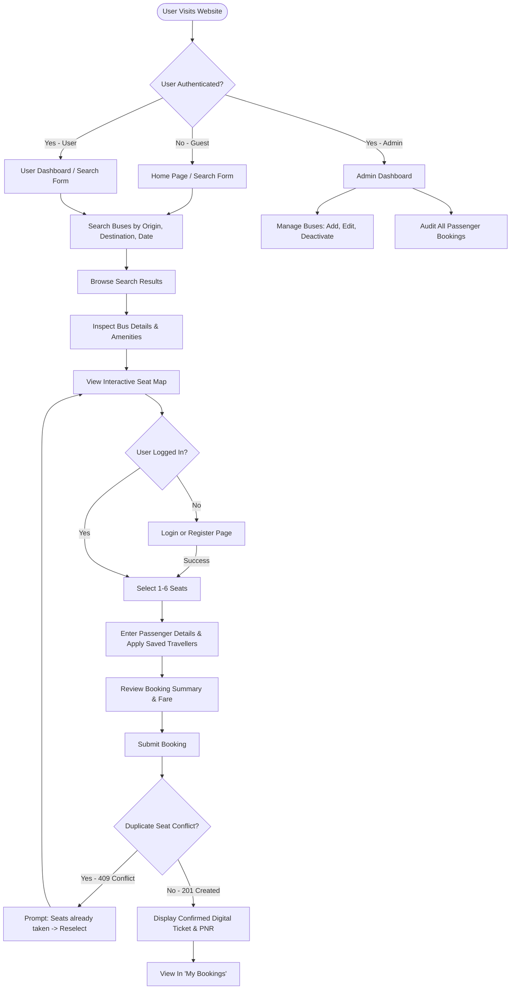
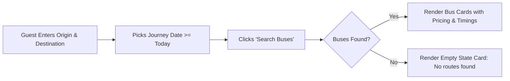
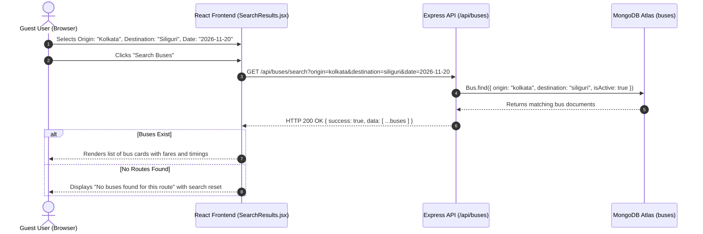
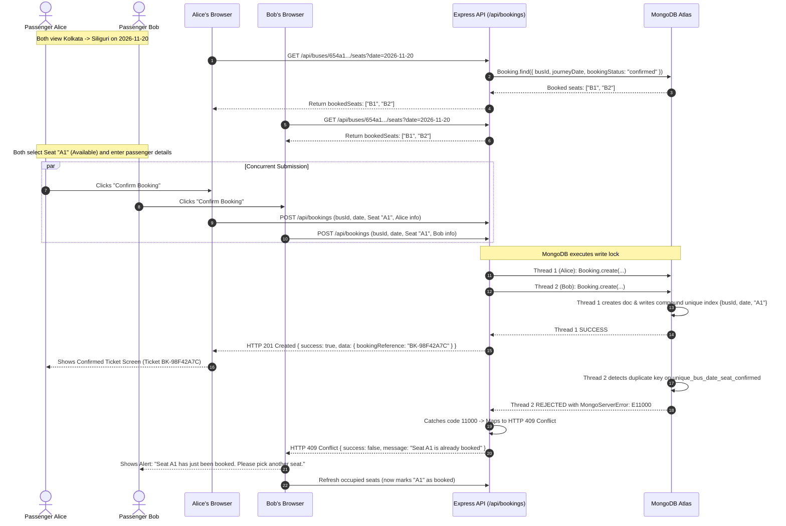
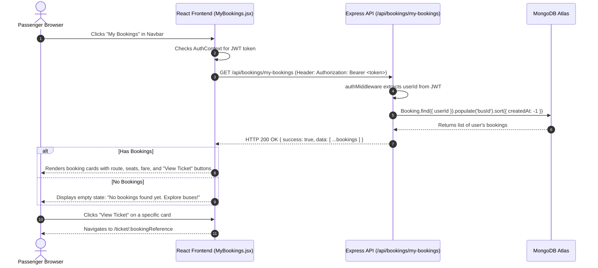
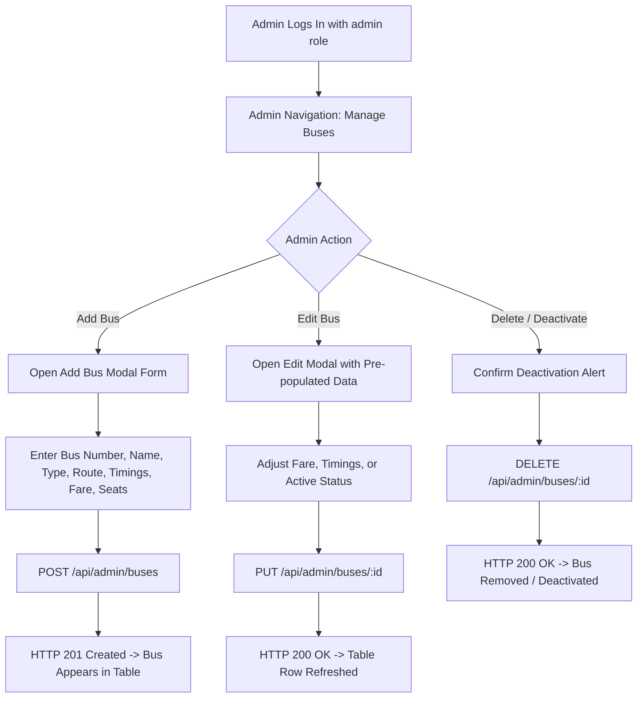
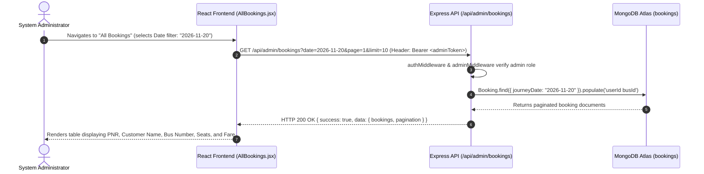
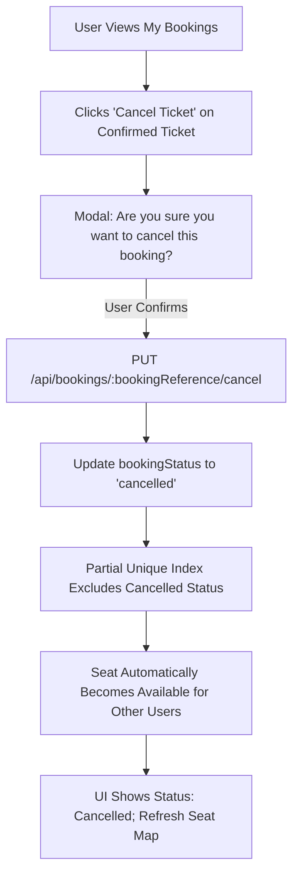
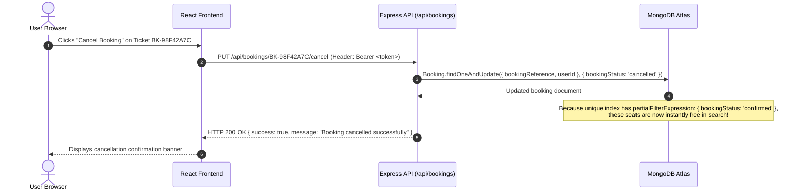

# Application Flows & Sequence Diagrams

## Bus Booking App — Online Bus Ticket Booking System

This document visualizes all key operational workflows of the **Bus Booking App** using Mermaid flowcharts and sequence diagrams. Every flow includes step-by-step explanatory text and explicitly maps each action to its corresponding backend REST API endpoint.

---

## 1. System Navigation & High-Level User Flow



---

## 2. Guest Bus Search Flow

Enables guests to search available buses without registering.

### 2.1 Flowchart


### 2.2 Sequence Diagram


**API Endpoint Called**: `GET /api/buses/search?origin=:origin&destination=:destination&date=:date`

---

## 3. User Registration & Authentication Flow

Covers account creation, login credential verification, and JWT session issuance.

### 3.1 Flowchart
```mermaid
flowchart TD
    Start([User Navigates to /register or /login]) --> Action{Register or Login?}
    
    Action -->|Register| RegForm[Enter Name, Email, Password, Phone]
    RegForm --> ValidateReg{Client & Server Validation Pass?}
    ValidateReg -->|No| RegErr[Display Inline Field Errors]
    ValidateReg -->|Yes| CheckEmail{Email Already Registered?}
    CheckEmail -->|Yes| Conflict[Return 409 Conflict: Email taken]
    CheckEmail -->|No| HashPass[Hash Password with bcryptjs (10 rounds)]
    HashPass --> SaveUser[Save User to MongoDB]
    SaveUser --> LoginRedirect[Redirect to /login with Success Banner]
    
    Action -->|Login| LoginForm[Enter Email and Password]
    LoginForm --> VerifyCreds{Email & Password Match?}
    VerifyCreds -->|No| LoginErr[Return 401 Unauthorized: Invalid credentials]
    VerifyCreds -->|Yes| GenJWT[Sign JWT Token (24h expiry)]
    GenJWT --> SaveLocal[Save Token & User to localStorage]
    SaveLocal --> HydrateContext[Update React AuthContext]
    HydrateContext --> RedirectHome[Redirect to intended page / Home]
```

### 3.2 Sequence Diagram
```mermaid
sequenceDiagram
    autonumber
    actor User as User Browser
    participant React as React Frontend (Login.jsx / AuthContext)
    participant API as Express API (/api/auth)
    participant DB as MongoDB Atlas (users)

    User->>React: Enters email and password; clicks "Login"
    React->>API: POST /api/auth/login { email, password }
    API->>DB: User.findOne({ email: email.toLowerCase() })
    DB-->>API: User record (with password hash)
    API->>API: bcrypt.compare(password, user.password)
    alt Passwords Match
        API->>API: jwt.sign({ id: user._id, role: user.role }, JWT_SECRET, { expiresIn: '24h' })
        API-->>React: HTTP 200 OK { success: true, data: { token, user } }
        React->>React: localStorage.setItem('token', token); update AuthContext state
        React-->>User: Navigate to previous page or /
    else Mismatch or User Not Found
        API-->>React: HTTP 401 Unauthorized { success: false, message: "Invalid email or password" }
        React-->>User: Display alert: "Invalid email or password"
    end
```

**API Endpoints Called**:
- Registration: `POST /api/auth/register`
- Login: `POST /api/auth/login`
- Session Hydration: `GET /api/auth/me`

---

## 4. Seat Selection & Concurrency-Safe Booking Flow

The primary application transaction: allows seat inspection, group booking (1–6 seats), and handles database-level collision prevention.

### 4.1 Flowchart
```mermaid
flowchart TD
    SelectBus[User Clicks 'Select Seats' on Bus Card] --> LoadSeats[Fetch Occupied Seats for Date]
    LoadSeats --> RenderMap[Render Interactive 2x2 Seat Layout]
    RenderMap --> UserToggles[User Clicks 1-6 Available Seats]
    UserToggles --> SeatCountCheck{Seats Count <= 6?}
    SeatCountCheck -->|No| Warning[Toast: Maximum 6 seats per booking]
    SeatCountCheck -->|Yes| UpdateFare[Live Update Total Fare: count * fare]
    UpdateFare --> NextPass[Proceed to Passenger Details]
    NextPass --> FillDetails[Enter Names, Ages, Genders or Apply Saved Travellers]
    FillDetails --> CheckoutReview[Review Booking Summary & PNR Preview]
    CheckoutReview --> SubmitBooking[User Clicks 'Confirm Booking']
    SubmitBooking --> AtomicInsert[MongoDB Booking.create() with Unique Concurrency Index]
    AtomicInsert --> DuplicateCollision{Index Collision Error 11000?}
    DuplicateCollision -->|Yes| HandleConflict[Catch 11000 -> Return HTTP 409 Conflict]
    HandleConflict --> ConflictUI[Alert: 'Seats taken by another user' -> Reload Seat Map]
    DuplicateCollision -->|No| SuccessInsert[HTTP 201 Created -> Return Confirmed Ticket]
    SuccessInsert --> TicketView[Navigate to /ticket/:bookingReference]
```

### 4.2 Sequence Diagram (Including Duplicate Seat Conflict Path)


**API Endpoints Called**:
- Fetch Occupancy: `GET /api/buses/:id/seats?date=:date`
- Fetch Saved Travellers: `GET /api/travellers`
- Create Booking: `POST /api/bookings`
- Fetch Ticket: `GET /api/bookings/:bookingReference`

---

## 5. Booking History & Ticket Retrieval Flow

Allows passengers to access previous tickets and upcoming journeys.

### 5.1 Sequence Diagram


**API Endpoint Called**: `GET /api/bookings/my-bookings`

---

## 6. Admin Bus Fleet Management Flow (CRUD)

Restricted administrative operations allowing bus operators to manage fleet schedules.

### 6.1 Flowchart


### 6.2 Sequence Diagram
```mermaid
sequenceDiagram
    autonumber
    actor Admin as System Administrator
    participant UI as React Frontend (ManageBuses.jsx)
    participant API as Express API (/api/admin/buses)
    participant DB as MongoDB Atlas (buses)

    Admin->>UI: Submits new bus form (Bus Number: "WB-04-E-9999", Fare: 850)
    UI->>API: POST /api/admin/buses (Header: Bearer <adminToken>)
    API->>API: authMiddleware verifies JWT
    API->>API: adminMiddleware verifies req.user.role === 'admin'
    alt Not Admin
        API-->>UI: HTTP 403 Forbidden { success: false, message: "Access denied" }
    else Admin Verified
        API->>DB: Bus.create({ ...busData })
        DB-->>API: Created bus document
        API-->>UI: HTTP 201 Created { success: true, data: { ...newBus } }
        UI-->>Admin: Displays success banner; refreshes bus table
    end
```

**API Endpoints Called**:
- List Fleet: `GET /api/admin/buses`
- Create Bus: `POST /api/admin/buses`
- Update Bus: `PUT /api/admin/buses/:id`
- Delete Bus: `DELETE /api/admin/buses/:id`

---

## 7. Admin All Bookings Audit Flow

Enables administrators to view and filter all passenger bookings placed across the platform.

### 7.1 Sequence Diagram


**API Endpoint Called**: `GET /api/admin/bookings?date=:date&page=:page&limit=:limit`

---

## 8. Token Expiry & Unauthorized Handling Flow

Protects private routes and handles graceful logout when JWT tokens expire.

### 8.1 Sequence Diagram
```mermaid
sequenceDiagram
    autonumber
    actor User as User Browser
    participant Axios as Axios Interceptor (services/api.js)
    participant API as Express API
    participant React as React Router & AuthContext

    User->>Axios: Performs action requiring authentication (e.g. view ticket)
    Axios->>API: GET /api/bookings/BK-98F42A7C (Expired Bearer Token)
    API->>API: authMiddleware calls jwt.verify(token) -> Throws TokenExpiredError
    API-->>Axios: HTTP 401 Unauthorized { success: false, message: "Token expired. Please login again." }
    Axios->>Axios: Interceptor detects status 401
    Axios->>React: Dispatches LOGOUT action; clears localStorage token
    React-->>User: Redirects to /login with notification: "Your session has expired. Please log in again."
```

---

## 9. Planned Booking Cancellation Flow (Post-MVP)

Enables users to cancel confirmed reservations and frees up allocated seats.

### 9.1 Flowchart


### 9.2 Sequence Diagram


**API Endpoint Called**: `PUT /api/bookings/:bookingReference/cancel` *(Post-MVP)*
