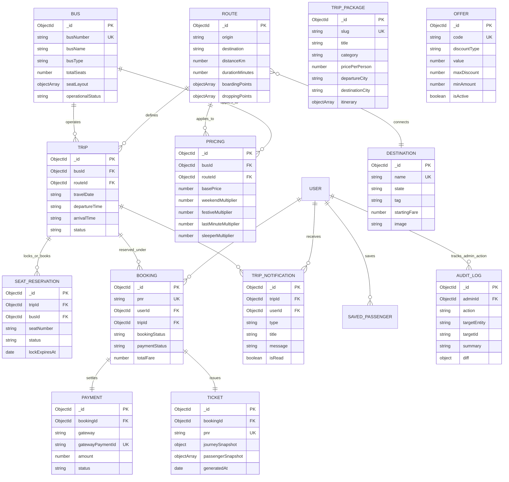

# Database Schema Specification

## Bus Booking App — Online Bus Ticket Booking System

This document provides the definitive database architecture for the **Bus Booking App**. It defines all MongoDB collections, field types, validation constraints, indexes, relationships, Mongoose schema implementations, sample operational queries, and future schema migrations.

---

## 1. Architecture Overview & Design Principles

The database layer is built on **MongoDB** accessed via **Mongoose ODM** (v8+ / v9+). It balances normalized relational integrity with document embedding to achieve optimal read throughput for public bus searches and atomic safety for concurrent seat bookings.

### Key Architectural Decisions:
1. **Passenger Embedding vs. Normalization**:
   - Passengers in a booking are embedded directly inside the `Booking` document as an array (`passengers`). This ensures an entire ticket with all seat assignments and passenger details is written atomically in a single document write.
2. **Preventing Double Booking via Database-Level Constraints**:
   - Double-booking the same seat on the same bus for the same journey date is prevented at the database engine level via a **Compound Partial Unique Index** on `{ "busId": 1, "journeyDate": 1, "passengers.seatNumber": 1 }` with a partial filter `{ "bookingStatus": "confirmed" }`.
   - Any concurrent request attempting to book an already confirmed seat violates this index and triggers a MongoDB `E11000` duplicate key exception, completely preventing race conditions without requiring complex distributed locks.
3. **Dedicated `SavedTraveller` Collection**:
   - Registered users frequently book for family, colleagues, or themselves. Frequent passenger profiles are stored in a dedicated `savedtravellers` collection linked by `userId` foreign reference.
4. **Dates and Timings**:
   - `journeyDate` is standardized to UTC midnight (`YYYY-MM-DDT00:00:00.000Z`) to allow clean equality matching.
   - `departureTime` and `arrivalTime` are stored as 24-hour formatted strings (`HH:mm`) for readable display and cross-day journey calculations.

---

## 2. Entity-Relationship (ER) Diagram (OBTBS Trip-Centric)



---

## 3. Collections & Data Dictionary

### 3.1 `users` Collection

Stores authentication credentials and basic profile information for registered passengers and administrators.

| Field Name | Type | Constraints | Description |
| :--- | :--- | :--- | :--- |
| `_id` | `ObjectId` | Primary Key, Auto-generated | Unique user identifier. |
| `name` | `String` | Required, Trimmed, Length: 2–50 | Full name of the user. |
| `email` | `String` | Required, Unique, Lowercase, Trimmed | Unique login email address. |
| `password` | `String` | Required, Min length 6 | Salted bcrypt hash of user password (never plaintext). |
| `phone` | `String` | Required, Trimmed, Regex: `^[0-9]{10}$` | 10-digit primary mobile contact number. |
| `role` | `String` | Required, Enum: `['user', 'admin']`, Default: `'user'` | System authorization role. |
| `createdAt` | `Date` | Auto-managed by Mongoose | Timestamp of registration. |
| `updatedAt` | `Date` | Auto-managed by Mongoose | Timestamp of last record update. |

---

### 3.2 `savedtravellers` Collection

Stores saved passenger profiles associated with a registered user to facilitate one-click passenger addition during checkout.

| Field Name | Type | Constraints | Description |
| :--- | :--- | :--- | :--- |
| `_id` | `ObjectId` | Primary Key, Auto-generated | Unique record identifier. |
| `userId` | `ObjectId` | Required, Ref: `'User'`, Indexed | Foreign key linking traveller to owner user. |
| `name` | `String` | Required, Trimmed, Length: 2–50 | Full legal name of traveller. |
| `age` | `Number` | Required, Min: 1, Max: 120 | Age of traveller in completed years. |
| `gender` | `String` | Required, Enum: `['male', 'female', 'other']` | Gender identification for seat arrangement. |
| `createdAt` | `Date` | Auto-managed by Mongoose | Timestamp created. |
| `updatedAt` | `Date` | Auto-managed by Mongoose | Timestamp updated. |

---

### 3.3 `buses` Collection

Master inventory of buses managed by administrators, defining routes, schedules, seat capacities, and base fares.

| Field Name | Type | Constraints | Description |
| :--- | :--- | :--- | :--- |
| `_id` | `ObjectId` | Primary Key, Auto-generated | Unique bus inventory identifier. |
| `busNumber` | `String` | Required, Unique, Uppercase, Trimmed | Registration number (e.g., `"WB-04-A-1234"`). |
| `busName` | `String` | Required, Trimmed, Length: 2–100 | YatraBus fleet vehicle label (e.g., `"YatraBus AC Sleeper"`). |
| `busType` | `String` | Required, Enum: `['Seater', 'Sleeper', 'AC Seater', 'AC Sleeper']` | Physical layout and comfort category. |
| `origin` | `String` | Required, Lowercase, Trimmed, Indexed | Origin city or boarding terminal (e.g., `"kolkata"`). |
| `destination` | `String` | Required, Lowercase, Trimmed, Indexed | Destination city or dropping terminal (e.g., `"siliguri"`). |
| `departureTime` | `String` | Required, Format: `HH:mm` (24-hour) | Scheduled departure time (e.g., `"20:30"`). |
| `arrivalTime` | `String` | Required, Format: `HH:mm` (24-hour) | Scheduled arrival time (e.g., `"06:30"`). |
| `journeyDuration` | `String` | Required, Format: `"Xh Ym"` | Calculated duration (e.g., `"10h 00m"`). |
| `fare` | `Number` | Required, Min: 1 | Standard fare per seat in INR (₹). |
| `totalSeats` | `Number` | Required, Min: 10, Max: 60, Default: 36 | Total seat capacity (layout grid size). |
| `amenities` | `[String]` | Array of strings | Amenities offered (e.g., `["WiFi", "Water Bottle", "Charging Point", "Blanket"]`). |
| `isActive` | `Boolean` | Required, Default: `true`, Indexed | Flag indicating whether bus is actively scheduled. |
| `createdAt` | `Date` | Auto-managed by Mongoose | Creation timestamp. |
| `updatedAt` | `Date` | Auto-managed by Mongoose | Last modification timestamp. |

---

### 3.4 `bookings` Collection

Stores confirmed reservations placed by users. Contains embedded subdocuments for individual passengers and seat assignments.

| Field Name | Type | Constraints | Description |
| :--- | :--- | :--- | :--- |
| `_id` | `ObjectId` | Primary Key, Auto-generated | Unique booking identifier. |
| `bookingReference` | `String` | Required, Unique, Uppercase, Trimmed | Human-readable PNR code (e.g., `"BK-98F42A7C"`). |
| `userId` | `ObjectId` | Required, Ref: `'User'`, Indexed | Foreign key linking booking to customer. |
| `busId` | `ObjectId` | Required, Ref: `'Bus'`, Indexed | Foreign key linking booking to bus schedule. |
| `journeyDate` | `Date` | Required, Normalized to UTC midnight | Date of travel (ISO date string `YYYY-MM-DDT00:00:00.000Z`). |
| `passengers` | `[SubDoc]` | Required, Array min length: 1, max length: 6 | List of passengers booked under this ticket. |
| `passengers.seatNumber` | `String` | Required, Uppercase, Trimmed (e.g., `"A1"`) | Specific allocated seat code. |
| `passengers.name` | `String` | Required, Trimmed, Length: 2–50 | Passenger legal name. |
| `passengers.age` | `Number` | Required, Min: 1, Max: 120 | Passenger age. |
| `passengers.gender` | `String` | Required, Enum: `['male', 'female', 'other']` | Passenger gender. |
| `totalFare` | `Number` | Required, Min: 1 | Total price calculated (`passengers.length * bus.fare`). |
| `bookingStatus` | `String` | Required, Enum: `['confirmed', 'cancelled']`, Default: `'confirmed'` | Lifecycle state of ticket (`'cancelled'` is Post-MVP). |
| `paymentStatus` | `String` | Required, Enum: `['paid', 'unpaid', 'mock_paid']`, Default: `'paid'` | Payment status (`'mock_paid'` for test flow). |
| `createdAt` | `Date` | Auto-managed by Mongoose | Booking time. |
| `updatedAt` | `Date` | Auto-managed by Mongoose | Modification time. |

---

### 3.5 `trips` Collection

Defines specific scheduled departures for a vehicle along an assigned route on a given travel date.

| Field Name | Type | Constraints | Description |
| :--- | :--- | :--- | :--- |
| `_id` | `ObjectId` | Primary Key, Auto-generated | Unique trip identifier. |
| `busId` | `ObjectId` | Required, Ref: `'Bus'`, Indexed | Foreign key linking trip to physical vehicle. |
| `routeId` | `ObjectId` | Required, Ref: `'Route'`, Indexed | Foreign key linking trip to geographic route. |
| `travelDate` | `String` | Required, Format: `YYYY-MM-DD`, Indexed | Calendar date of scheduled trip departure. |
| `departureTime` | `String` | Required, Format: `HH:mm` | 24-hour departure time. |
| `arrivalTime` | `String` | Required, Format: `HH:mm` | 24-hour estimated arrival time. |
| `status` | `String` | Required, Enum: `['scheduled', 'active', 'completed', 'cancelled']`, Default: `'scheduled'` | Operational state of the trip. |
| `boardingPoints` | `[SubDoc]` | Array of stop objects | Boarding locations with names and times. |
| `droppingPoints` | `[SubDoc]` | Array of stop objects | Dropping locations with names and times. |
| `createdAt` / `updatedAt` | `Date` | Auto-managed by Mongoose | Audit timestamps. |

---

### 3.6 `seatreservations` Collection

Tracks real-time atomic seat locks (8-minute TTL) and confirmed bookings per trip, keyed strictly by `(tripId, seatNumber)`.

| Field Name | Type | Constraints | Description |
| :--- | :--- | :--- | :--- |
| `_id` | `ObjectId` | Primary Key, Auto-generated | Unique reservation identifier. |
| `tripId` | `ObjectId` | Required, Ref: `'Trip'`, Indexed | Associated scheduled trip. |
| `busId` | `ObjectId` | Required, Ref: `'Bus'` | Associated physical bus. |
| `seatNumber` | `String` | Required, Uppercase, Trimmed | Physical seat label (e.g., `"L1"`, `"U4"`). |
| `status` | `String` | Required, Enum: `['locked', 'booked']` | Current state of seat. |
| `userId` | `ObjectId` | Required, Ref: `'User'`, Indexed | User holding or booking the seat. |
| `lockedAt` | `Date` | Timestamp of lock acquisition | Used to evaluate lock age. |
| `lockExpiresAt` | `Date` | Indexed (TTL) | Expiration timestamp for temporary hold (now + 8 min). |
| `bookingId` | `ObjectId` | Ref: `'Booking'`, Default: `null` | Reference to finalized booking once confirmed. |

---

### 3.7 `pricing` Collection

Enforces multi-tier dynamic pricing with surge, weekend, festive, last-minute, and seat-position multipliers.

| Field Name | Type | Constraints | Description |
| :--- | :--- | :--- | :--- |
| `_id` | `ObjectId` | Primary Key, Auto-generated | Unique pricing rule identifier. |
| `busId` | `ObjectId` | Ref: `'Bus'`, Default: `null`, Indexed | Bus-specific pricing override. |
| `routeId` | `ObjectId` | Ref: `'Route'`, Default: `null`, Indexed | Route-specific pricing override. |
| `tripId` | `ObjectId` | Ref: `'Trip'`, Default: `null`, Indexed | Trip-specific pricing override. |
| `seatType` | `String` | Enum: `['sleeper', 'seater', 'semi-sleeper', 'all']`, Default: `'all'` | Target seat category. |
| `basePrice` | `Number` | Required, Min: 0 | Baseline fare in INR (₹). |
| `additionalCharges` | `Number` | Default: 0, Min: 0 | Toll, terminal, or cleaning fees. |
| `taxPercent` | `Number` | Default: 5, Min: 0 | Goods and Services Tax (GST) rate. |
| `dayOfWeekMultiplier` | `Number` | Default: 1.0, Range: 0.5–3.0 | Weekday dynamic surge rate. |
| `weekendMultiplier` | `Number` | Default: 1.2, Range: 0.5–3.0 | Friday/Saturday/Sunday peak multiplier. |
| `festiveMultiplier` | `Number` | Default: 1.25, Range: 0.5–3.0 | Festival/holiday season multiplier. |
| `lastMinuteMultiplier` | `Number` | Default: 1.15, Range: 0.5–3.0 | Surge applied when booking within 12 hours of departure. |
| `sleeperMultiplier` | `Number` | Default: 1.2, Range: 0.5–3.0 | Premium for sleeper berths. |
| `lowerBerthMultiplier` | `Number` | Default: 1.1, Range: 0.5–3.0 | Premium for convenient lower berths. |
| `frontRowMultiplier` | `Number` | Default: 1.05, Range: 0.5–3.0 | Premium for front-row panoramic seats. |
| `isActive` | `Boolean` | Default: `true`, Indexed | Rule active switch. |

---

### 3.8 `trippackages` Collection

Curated weekend circuits, religious pilgrimages, and seasonal leisure packages with day-by-day itineraries.

| Field Name | Type | Constraints | Description |
| :--- | :--- | :--- | :--- |
| `_id` | `ObjectId` | Primary Key, Auto-generated | Unique package identifier. |
| `title` | `String` | Required, Trimmed | Tour circuit title (e.g., `"Digha & Mandarmani Coastal Retreat"`). |
| `slug` | `String` | Required, Unique, Lowercase, Indexed | SEO URL slug. |
| `category` | `String` | Required, Enum: `['Pilgrim', 'Konkan', 'Leisure', 'Monsoon', 'Heritage']`, Indexed | Circuit travel genre. |
| `durationDays` | `Number` | Required, Min: 1 | Total days duration. |
| `durationNights` | `Number` | Required, Min: 0 | Total nights duration. |
| `packageType` | `String` | Required, Trimmed | Subtitle/badge label (e.g., `"Weekend Beach Circuit"`). |
| `pricePerPerson` | `Number` | Required, Min: 0, Indexed | All-inclusive rate per traveller in INR. |
| `departureCity` | `String` | Required, Trimmed, Indexed | Primary origin hub. |
| `destinationCity` | `String` | Required, Trimmed, Indexed | Final turnaround destination. |
| `image` | `String` | Required, URL | High-resolution cover photo. |
| `routeDescription` | `String` | Required, Trimmed | Geographic itinerary trajectory. |
| `itinerary` | `[SubDoc]` | Array of `{ day, title, description, meals }` | Comprehensive daily travel plan. |
| `inclusions` | `[String]` | Array of strings | Included services (e.g. AC Bus, Hotel, Breakfast). |
| `exclusions` | `[String]` | Array of strings | Excluded services (e.g. Lunch, Monument Fees). |
| `availableDays` | `[String]` | Array of days | Departure weekdays (e.g. `['Friday', 'Saturday']`). |
| `featured` | `Boolean` | Default: `false`, Indexed | Highlight flag for homepage carousels. |
| `isActive` | `Boolean` | Default: `true`, Indexed | Visibility switch. |

---

### 3.9 `destinations` Collection

Curated destination guides showcasing highlights, regional pickup hubs, and baseline bus fares.

| Field Name | Type | Constraints | Description |
| :--- | :--- | :--- | :--- |
| `_id` | `ObjectId` | Primary Key, Auto-generated | Unique destination identifier. |
| `name` | `String` | Required, Unique, Trimmed, Indexed | Destination city or town (e.g., `"Digha"`). |
| `state` | `String` | Required, Trimmed, Indexed | Indian state or UT (e.g., `"West Bengal"`). |
| `tag` | `String` | Enum: `['Hill Station', 'Heritage', 'Beach', 'Pilgrimage', 'Wildlife', 'City', 'Spiritual']`, Indexed | Destination theme. |
| `title` | `String` | Required, Trimmed | Prominent marketing headline. |
| `description` | `String` | Required, Trimmed | Narrative overview of the locale. |
| `image` | `String` | Required, URL | Curated cover photography. |
| `gallery` | `[String]` | Array of URLs | Additional photo gallery. |
| `highlights` | `[String]` | Array of strings | Key sights and experiences. |
| `popularPickups` | `[String]` | Array of strings | Common regional boarding terminals. |
| `startingFare` | `Number` | Default: 450, Min: 0 | Lead bus transit price. |
| `isActive` | `Boolean` | Default: `true`, Indexed | Publication toggle. |

---

### 3.10 `offers` Collection

Promotional coupons, bank card rebates, and festive discounts validated on the server.

| Field Name | Type | Constraints | Description |
| :--- | :--- | :--- | :--- |
| `_id` | `ObjectId` | Primary Key, Auto-generated | Unique coupon identifier. |
| `code` | `String` | Required, Unique, Uppercase, Indexed | Coupon code (e.g., `"YATRAFIRST"`, `"FESTIVE50"`). |
| `title` | `String` | Required, Trimmed | Promo campaign headline. |
| `description` | `String` | Trimmed | Promo conditions and benefits summary. |
| `discountType` | `String` | Enum: `['percent', 'flat']`, Default: `'percent'` | Calculation algorithm. |
| `value` | `Number` | Required, Min: 0 | Discount percentage or flat INR value. |
| `maxDiscount` | `Number` | Min: 0, Default: 0 | Upper discount limit (for percent type). |
| `minAmount` | `Number` | Min: 0, Default: 0 | Minimum booking cart total required. |
| `validFrom` / `validTo` | `String` | Format: `YYYY-MM-DD` | Active date window. |
| `usageLimit` | `Number` | Min: 0, Default: 0 | Maximum allowable redeems (0 = unlimited). |
| `usedCount` | `Number` | Min: 0, Default: 0 | Number of times redeemed so far. |
| `applicableRoutes`| `[String]` | Array of route names | Whitelisted routes (empty = all routes). |
| `isActive` | `Boolean` | Default: `true`, Indexed | Campaign switch. |
| `badge` | `String` | Display badge label (e.g. `"POPULAR"`, `"FESTIVE"`) | UI badge. |

---

### 3.11 `auditlogs` Collection

Chronological system audit trail recording every administrative modification with before/after diffs and IP addresses.

| Field Name | Type | Constraints | Description |
| :--- | :--- | :--- | :--- |
| `_id` | `ObjectId` | Primary Key, Auto-generated | Unique log identifier. |
| `adminId` | `ObjectId` | Ref: `'User'`, Default: `null`, Indexed | ID of the acting administrator. |
| `adminEmail` | `String` | Trimmed, Indexed | Email address of the administrator. |
| `action` | `String` | Required, Trimmed, Indexed | System action code (`CREATE_BUS`, `UPDATE_LAYOUT`, `ADJUST_WALLET`, etc.). |
| `targetEntity` | `String` | Required, Trimmed, Indexed | Target collection name (`Bus`, `Trip`, `User`, `Booking`). |
| `targetId` | `String` | Default: `""` | Target resource ObjectId string. |
| `summary` | `String` | Required, Trimmed | Human-readable audit narrative. |
| `diff` | `Mixed` | Default: `null` | JSON object containing change payload or before/after state. |
| `ipAddress` | `String` | Default: `""` | Origin IP of request. |
| `createdAt` | `Date` | Indexed (`-1`) | Timestamp of administrative event. |

---

### 3.12 `tripnotifications` Collection

Customer delay and cancellation alerts dispatched automatically when an administrator modifies trip schedules.

| Field Name | Type | Constraints | Description |
| :--- | :--- | :--- | :--- |
| `_id` | `ObjectId` | Primary Key, Auto-generated | Unique notification identifier. |
| `tripId` | `ObjectId` | Required, Ref: `'Trip'`, Indexed | Impacted trip. |
| `bookingId` | `ObjectId` | Ref: `'Booking'`, Default: `null`, Indexed | Customer's specific booking. |
| `userId` | `ObjectId` | Required, Ref: `'User'`, Indexed | Passenger recipient. |
| `type` | `String` | Enum: `['DELAY', 'CANCELLATION', 'SCHEDULE_CHANGE', 'GENERAL']` | Alert category. |
| `title` | `String` | Required, Trimmed | Alert title. |
| `message` | `String` | Required, Trimmed | Notification message body. |
| `isRead` | `Boolean` | Default: `false`, Indexed | Read state indicator. |
| `createdAt` | `Date` | Timestamp | Delivery timestamp. |

---

### 3.13 `platformsettings` Collection

System-wide platform branding, operational rules, and service charges.

| Field Name | Type | Constraints | Description |
| :--- | :--- | :--- | :--- |
| `_id` | `ObjectId` | Primary Key, Auto-generated | Unique record identifier. |
| `key` | `String` | Required, Unique, Default: `'platform'` | Configuration key. |
| `values` | `Mixed` | Required, Default: `{}` | JSON dictionary holding `siteName`, `brandTagline`, `logoUrl`, `cancelPolicyHours`, `cancelRefundPercent`, `serviceChargeFlat`. |

---

---

## 4. Indexing Strategy & Concurrency Enforcement

### 4.1 The Concurrency Index: Duplicate Seat Prevention

To guarantee that **two passengers cannot book the same seat on the same bus for the same date**, MongoDB's multikey index mechanism is combined with a partial filter.

```javascript
// Compound partial unique index definition in Mongoose
BookingSchema.index(
  {
    busId: 1,
    journeyDate: 1,
    "passengers.seatNumber": 1
  },
  {
    unique: true,
    partialFilterExpression: { bookingStatus: "confirmed" },
    name: "unique_bus_date_seat_confirmed"
  }
);
```

#### How this protects against race conditions:
1. Two concurrent clients (`User A` and `User B`) both inspect the seat layout for Bus `X` on date `2026-11-20` and both pick seat `"A1"`.
2. Both submit checkout requests at the exact same millisecond.
3. Node.js threads issue `Booking.create()` concurrently to MongoDB.
4. MongoDB acquires a document lock. The first write succeeds and creates index keys:
   `{ busId: X, journeyDate: 2026-11-20, "passengers.seatNumber": "A1" }`.
5. When the second write attempts insertion, MongoDB's unique index constraint immediately detects the duplicate key collision on `"passengers.seatNumber": "A1"`.
6. MongoDB aborts the second insert and raises error code `11000` (`MongoServerError: E11000 duplicate key error`).
7. The backend controller catches error code `11000` and immediately responds to `User B` with HTTP `409 Conflict`:
   ```json
   {
     "success": false,
     "message": "One or more selected seats (A1) have already been booked. Please select other seats."
   }
   ```
8. **Post-MVP Cancellation Support**: If `User A` later cancels their booking, `bookingStatus` changes to `'cancelled'`. Because the index specifies `partialFilterExpression: { bookingStatus: "confirmed" }`, the cancelled document is excluded from the unique constraint, instantly making seat `"A1"` available for other users without requiring manual index deletion.

### 4.2 Complete Index Summary Table

| Collection | Indexed Fields | Type | Purpose / Query Optimization |
| :--- | :--- | :--- | :--- |
| `users` | `{ email: 1 }` | Unique | Fast credential lookup during login & unique email enforcement. |
| `savedpassengers` | `{ userId: 1 }` | Single Field | Fast retrieval of user's saved passenger roster. |
| `buses` | `{ busNumber: 1 }` | Unique | Enforces vehicle registration number uniqueness. |
| `routes` | `{ origin: 1, destination: 1 }` | Compound | Route lookup and distance/time matching. |
| `trips` | `{ busId: 1, travelDate: 1, departureTime: 1 }` | **Compound Unique** | **Prevents vehicle double-scheduling conflicts across batch generators.** |
| `trips` | `{ travelDate: 1, status: 1 }` | Compound | Fast public search by travel date and schedule filtering. |
| `seatreservations` | `{ tripId: 1, seatNumber: 1 }` | **Compound Unique** | **Zero-concurrency race condition double-locking prevention (ACID transaction-guaranteed).** |
| `seatreservations` | `{ lockExpiresAt: 1 }` | TTL | Automatic lock expiration after 8-minute TTL. |
| `bookings` | `{ bookingReference: 1 }`, `{ pnr: 1 }` | Unique | Instant PNR ticket lookup. |
| `bookings` | `{ userId: 1, createdAt: -1 }` | Compound | Speeds up "My Bookings" sorted chronologically. |
| `bookings` | `{ busId: 1, journeyDate: 1, bookingStatus: 1 }` | Compound | Safety check for future confirmed bookings before layout/bus modifications. |
| `pricing` | `{ busId: 1, routeId: 1 }`, `{ isActive: 1 }` | Compound | High-speed multi-tier dynamic pricing resolution. |
| `trippackages` | `{ slug: 1 }` | Unique | SEO package URL resolution. |
| `trippackages` | `{ category: 1, isActive: 1 }` | Compound | Category filtering for weekend circuits. |
| `trippackages` | `{ departureCity: 1, destinationCity: 1, isActive: 1 }` | Compound | Regional hub circuit search. |
| `destinations` | `{ name: 1 }` | Unique | Curated destination slug & name lookups. |
| `destinations` | `{ tag: 1, isActive: 1 }` | Compound | Destination thematic filtering. |
| `offers` | `{ code: 1 }` | Unique | Instant coupon code lookup during checkout validation. |
| `offers` | `{ isActive: 1, validTo: 1 }` | Compound | Active promotional campaign retrieval. |
| `auditlogs` | `{ createdAt: -1 }` | Single Field | Chronological audit log feeds for administrator dashboard. |
| `auditlogs` | `{ targetEntity: 1, action: 1 }` | Compound | Filtered audit inspection by resource and action. |
| `tripnotifications`| `{ userId: 1, isRead: 1, createdAt: -1 }` | Compound | Customer unread transit alert feeds. |

---

## 5. Mongoose Schema Implementations

The following code snippets are ready for drop-in use in the `backend/models/` folder.

### 5.1 `backend/models/User.js`
```javascript
const mongoose = require('mongoose');

const userSchema = new mongoose.Schema(
  {
    name: {
      type: String,
      required: [true, 'Name is required'],
      trim: true,
      minlength: [2, 'Name must be at least 2 characters'],
      maxlength: [50, 'Name cannot exceed 50 characters']
    },
    email: {
      type: String,
      required: [true, 'Email is required'],
      unique: true,
      lowercase: true,
      trim: true,
      match: [/^\w+([.-]?\w+)*@\w+([.-]?\w+)*(\.\w{2,3})+$/, 'Please provide a valid email']
    },
    password: {
      type: String,
      required: [true, 'Password is required'],
      minlength: [6, 'Password must be at least 6 characters']
    },
    phone: {
      type: String,
      required: [true, 'Phone number is required'],
      trim: true,
      match: [/^[0-9]{10}$/, 'Phone number must be exactly 10 digits']
    },
    role: {
      type: String,
      enum: {
        values: ['user', 'admin'],
        message: '{VALUE} is not a valid role'
      },
      default: 'user'
    }
  },
  { timestamps: true }
);

module.exports = mongoose.model('User', userSchema);
```

### 5.2 `backend/models/SavedTraveller.js`
```javascript
const mongoose = require('mongoose');

const savedTravellerSchema = new mongoose.Schema(
  {
    userId: {
      type: mongoose.Schema.Types.ObjectId,
      ref: 'User',
      required: [true, 'User ID is required'],
      index: true
    },
    name: {
      type: String,
      required: [true, 'Passenger name is required'],
      trim: true,
      minlength: [2, 'Name must be at least 2 characters'],
      maxlength: [50, 'Name cannot exceed 50 characters']
    },
    age: {
      type: Number,
      required: [true, 'Age is required'],
      min: [1, 'Age must be at least 1'],
      max: [120, 'Age cannot exceed 120']
    },
    gender: {
      type: String,
      required: [true, 'Gender is required'],
      enum: {
        values: ['male', 'female', 'other'],
        message: '{VALUE} is not a valid gender'
      }
    }
  },
  { timestamps: true }
);

module.exports = mongoose.model('SavedTraveller', savedTravellerSchema);
```

### 5.3 `backend/models/Bus.js`
```javascript
const mongoose = require('mongoose');

const busSchema = new mongoose.Schema(
  {
    busNumber: {
      type: String,
      required: [true, 'Bus number is required'],
      unique: true,
      uppercase: true,
      trim: true
    },
    busName: {
      type: String,
      required: [true, 'Bus name is required'],
      trim: true,
      minlength: [2, 'Bus name must be at least 2 characters'],
      maxlength: [100, 'Bus name cannot exceed 100 characters']
    },
    busType: {
      type: String,
      required: [true, 'Bus type is required'],
      enum: {
        values: ['Seater', 'Sleeper', 'AC Seater', 'AC Sleeper'],
        message: '{VALUE} is not a valid bus type'
      }
    },
    origin: {
      type: String,
      required: [true, 'Origin is required'],
      lowercase: true,
      trim: true
    },
    destination: {
      type: String,
      required: [true, 'Destination is required'],
      lowercase: true,
      trim: true
    },
    departureTime: {
      type: String,
      required: [true, 'Departure time is required (HH:mm)'],
      match: [/^([01]\d|2[0-3]):([0-5]\d)$/, 'Departure time must be in 24h format HH:mm']
    },
    arrivalTime: {
      type: String,
      required: [true, 'Arrival time is required (HH:mm)'],
      match: [/^([01]\d|2[0-3]):([0-5]\d)$/, 'Arrival time must be in 24h format HH:mm']
    },
    journeyDuration: {
      type: String,
      required: [true, 'Journey duration is required (e.g., 10h 00m)'],
      trim: true
    },
    fare: {
      type: Number,
      required: [true, 'Fare per seat is required'],
      min: [1, 'Fare must be greater than zero']
    },
    totalSeats: {
      type: Number,
      required: [true, 'Total seats count is required'],
      min: [10, 'Total seats must be at least 10'],
      max: [60, 'Total seats cannot exceed 60'],
      default: 36
    },
    amenities: {
      type: [String],
      default: ['Water Bottle', 'Charging Point']
    },
    isActive: {
      type: Boolean,
      default: true
    }
  },
  { timestamps: true }
);

// Compound index for bus search
busSchema.index({ origin: 1, destination: 1, isActive: 1 });

module.exports = mongoose.model('Bus', busSchema);
```

### 5.4 `backend/models/Booking.js`
```javascript
import mongoose from 'mongoose';

const passengerSubSchema = new mongoose.Schema(
  {
    seatNumber: { type: String, required: true, uppercase: true, trim: true },
    name: { type: String, required: true, trim: true, minlength: 2, maxlength: 50 },
    age: { type: Number, required: true, min: 1, max: 120 },
    gender: { type: String, required: true, enum: ['male', 'female', 'other'] }
  },
  { _id: false }
);

const bookingSchema = new mongoose.Schema(
  {
    bookingReference: { type: String, required: true, unique: true, uppercase: true, trim: true },
    pnr: { type: String, uppercase: true, trim: true },
    userId: { type: mongoose.Schema.Types.ObjectId, ref: 'User', required: true, index: true },
    tripId: { type: mongoose.Schema.Types.ObjectId, ref: 'Trip', index: true },
    busId: { type: mongoose.Schema.Types.ObjectId, ref: 'Bus', required: true, index: true },
    journeyDate: { type: Date, required: true },
    passengers: { type: [passengerSubSchema], required: true },
    totalFare: { type: Number, required: true, min: 1 },
    bookingStatus: { type: String, enum: ['pending', 'confirmed', 'cancelled', 'expired'], default: 'confirmed' },
    paymentStatus: { type: String, enum: ['unpaid', 'paid', 'refunded'], default: 'paid' }
  },
  { timestamps: true }
);

bookingSchema.index({ userId: 1, createdAt: -1 });
bookingSchema.index({ busId: 1, journeyDate: 1, bookingStatus: 1 });

export const Booking = mongoose.models.Booking || mongoose.model('Booking', bookingSchema);
```

### 5.5 `backend/models/TripPackage.js`
```javascript
import mongoose from 'mongoose';

const ItineraryDaySchema = new mongoose.Schema(
  {
    day: { type: Number, required: true },
    title: { type: String, required: true, trim: true },
    description: { type: String, required: true, trim: true },
    meals: { type: [String], default: [] },
  },
  { _id: false }
);

const TripPackageSchema = new mongoose.Schema(
  {
    title: { type: String, required: true, trim: true },
    slug: { type: String, required: true, unique: true, trim: true, lowercase: true, index: true },
    category: { type: String, enum: ['Pilgrim', 'Konkan', 'Leisure', 'Monsoon', 'Heritage'], required: true, index: true },
    durationDays: { type: Number, required: true, min: 1 },
    durationNights: { type: Number, required: true, min: 0 },
    packageType: { type: String, required: true, trim: true, default: 'Scenic Circuit' },
    pricePerPerson: { type: Number, required: true, min: 0, index: true },
    image: { type: String, required: true, trim: true },
    routeDescription: { type: String, required: true, trim: true },
    departureCity: { type: String, required: true, trim: true, index: true },
    destinationCity: { type: String, required: true, trim: true, index: true },
    itinerary: { type: [ItineraryDaySchema], default: [] },
    inclusions: { type: [String], default: ['AC Bus Travel', 'Accommodation', 'Complimentary Breakfast', 'Sightseeing Transfers'] },
    exclusions: { type: [String], default: ['Personal Expenses', 'Monument Entry Fees', 'Lunch and Dinner'] },
    availableDays: { type: [String], default: ['Friday', 'Saturday', 'Sunday'] },
    featured: { type: Boolean, default: false, index: true },
    isActive: { type: Boolean, default: true, index: true },
  },
  { timestamps: true }
);

TripPackageSchema.index({ category: 1, isActive: 1 });
TripPackageSchema.index({ departureCity: 1, destinationCity: 1, isActive: 1 });

export const TripPackage = mongoose.models.TripPackage || mongoose.model('TripPackage', TripPackageSchema);
```

### 5.6 `backend/models/AuditLog.js`
```javascript
import mongoose from 'mongoose';

const AuditLogSchema = new mongoose.Schema(
  {
    adminId: { type: mongoose.Schema.Types.ObjectId, ref: 'User', default: null, index: true },
    adminEmail: { type: String, default: 'system@yatrabus.com', trim: true, index: true },
    action: { type: String, required: true, trim: true, index: true },
    targetEntity: { type: String, required: true, trim: true, index: true },
    targetId: { type: String, default: '' },
    summary: { type: String, required: true, trim: true },
    diff: { type: mongoose.Schema.Types.Mixed, default: null },
    ipAddress: { type: String, default: '' },
  },
  { timestamps: true }
);

AuditLogSchema.index({ createdAt: -1 });

export const AuditLog = mongoose.models.AuditLog || mongoose.model('AuditLog', AuditLogSchema);
```

### 5.7 `backend/models/TripNotification.js`
```javascript
import mongoose from 'mongoose';

const TripNotificationSchema = new mongoose.Schema(
  {
    tripId: { type: mongoose.Schema.Types.ObjectId, ref: 'Trip', required: true, index: true },
    bookingId: { type: mongoose.Schema.Types.ObjectId, ref: 'Booking', default: null, index: true },
    userId: { type: mongoose.Schema.Types.ObjectId, ref: 'User', required: true, index: true },
    type: { type: String, enum: ['DELAY', 'CANCELLATION', 'SCHEDULE_CHANGE', 'GENERAL'], default: 'GENERAL', index: true },
    title: { type: String, required: true, trim: true },
    message: { type: String, required: true, trim: true },
    isRead: { type: Boolean, default: false, index: true },
  },
  { timestamps: true }
);

TripNotificationSchema.index({ userId: 1, isRead: 1, createdAt: -1 });

export const TripNotification = mongoose.models.TripNotification || mongoose.model('TripNotification', TripNotificationSchema);
```

### 5.8 `backend/models/Destination.js`
```javascript
import mongoose from 'mongoose';

const DestinationSchema = new mongoose.Schema(
  {
    name: { type: String, required: true, unique: true, trim: true, index: true },
    state: { type: String, required: true, trim: true, index: true },
    tag: { type: String, enum: ['Hill Station', 'Heritage', 'Beach', 'Pilgrimage', 'Wildlife', 'City', 'Spiritual'], default: 'Heritage', index: true },
    title: { type: String, required: true, trim: true },
    description: { type: String, required: true, trim: true },
    image: { type: String, required: true, trim: true },
    gallery: { type: [String], default: [] },
    highlights: { type: [String], default: [] },
    popularPickups: { type: [String], default: [] },
    startingFare: { type: Number, default: 450, min: 0 },
    isActive: { type: Boolean, default: true, index: true },
    seoTitle: { type: String, default: '' },
    seoDescription: { type: String, default: '' },
  },
  { timestamps: true }
);

export const Destination = mongoose.models.Destination || mongoose.model('Destination', DestinationSchema);
```

### 5.9 `backend/models/Pricing.js`
```javascript
import mongoose from 'mongoose';

const PricingSchema = new mongoose.Schema(
  {
    busId: { type: mongoose.Schema.Types.ObjectId, ref: 'Bus', default: null, index: true },
    routeId: { type: mongoose.Schema.Types.ObjectId, ref: 'Route', default: null, index: true },
    tripId: { type: mongoose.Schema.Types.ObjectId, ref: 'Trip', default: null, index: true },
    seatType: { type: String, enum: ['sleeper', 'seater', 'semi-sleeper', 'all'], default: 'all' },
    basePrice: { type: Number, required: true, min: 0 },
    additionalCharges: { type: Number, default: 0, min: 0 },
    taxPercent: { type: Number, default: 5, min: 0 },
    dayOfWeekMultiplier: { type: Number, default: 1.0, min: 0.5, max: 3.0 },
    weekendMultiplier: { type: Number, default: 1.2, min: 0.5, max: 3.0 },
    festiveMultiplier: { type: Number, default: 1.25, min: 0.5, max: 3.0 },
    lastMinuteMultiplier: { type: Number, default: 1.15, min: 0.5, max: 3.0 },
    sleeperMultiplier: { type: Number, default: 1.2, min: 0.5, max: 3.0 },
    lowerBerthMultiplier: { type: Number, default: 1.1, min: 0.5, max: 3.0 },
    frontRowMultiplier: { type: Number, default: 1.05, min: 0.5, max: 3.0 },
    isActive: { type: Boolean, default: true, index: true },
  },
  { timestamps: true }
);

export const Pricing = mongoose.models.Pricing || mongoose.model('Pricing', PricingSchema);
```

### 5.10 `backend/models/Offer.js`
```javascript
import mongoose from 'mongoose';

const OfferSchema = new mongoose.Schema(
  {
    code: { type: String, required: true, unique: true, trim: true, uppercase: true, index: true },
    title: { type: String, required: true, trim: true },
    description: { type: String, trim: true, default: '' },
    discountType: { type: String, enum: ['percent', 'flat'], default: 'percent' },
    value: { type: Number, required: true, min: 0 },
    maxDiscount: { type: Number, min: 0, default: 0 },
    minAmount: { type: Number, min: 0, default: 0 },
    validFrom: { type: String, default: null },
    validTo: { type: String, default: null },
    usageLimit: { type: Number, min: 0, default: 0 },
    usedCount: { type: Number, min: 0, default: 0 },
    applicableRoutes: { type: [String], default: [] },
    isActive: { type: Boolean, default: true, index: true },
    badge: { type: String, default: '' },
  },
  { timestamps: true }
);

export const Offer = mongoose.models.Offer || mongoose.model('Offer', OfferSchema);
```

### 5.11 `backend/models/PlatformSettings.js`
```javascript
import mongoose from 'mongoose';

const PlatformSettingsSchema = new mongoose.Schema(
  {
    key: { type: String, required: true, unique: true, default: 'platform' },
    values: { type: mongoose.Schema.Types.Mixed, required: true, default: {} },
  },
  { timestamps: true }
);

export const PlatformSettings = mongoose.models.PlatformSettings || mongoose.model('PlatformSettings', PlatformSettingsSchema);
```

---

## 6. Sample JSON Documents

### 6.1 `users` Sample Document
```json
{
  "_id": { "$oid": "654a1b2c3d4e5f6789a00001" },
  "name": "Arjun Sharma",
  "email": "arjun.sharma@example.com",
  "password": "$2a$10$w8TKnk2PzJ1E7oQZ/QzD3eFkLmOpQrStUvWxYzAbCdEfGhIjKlMn.",
  "phone": "9876543210",
  "role": "user",
  "createdAt": { "$date": "2026-11-01T10:00:00.000Z" },
  "updatedAt": { "$date": "2026-11-01T10:00:00.000Z" }
}
```

### 6.2 `savedtravellers` Sample Document
```json
{
  "_id": { "$oid": "654a1b2c3d4e5f6789a00055" },
  "userId": { "$oid": "654a1b2c3d4e5f6789a00001" },
  "name": "Priya Sharma",
  "age": 28,
  "gender": "female",
  "createdAt": { "$date": "2026-11-02T14:20:00.000Z" },
  "updatedAt": { "$date": "2026-11-02T14:20:00.000Z" }
}
```

### 6.3 `buses` Sample Document
```json
{
  "_id": { "$oid": "654a1b2c3d4e5f6789a00100" },
  "busNumber": "WB-04-E-5678",
  "busName": "YatraBus AC Sleeper",
  "busType": "AC Sleeper",
  "origin": "kolkata",
  "destination": "siliguri",
  "departureTime": "20:00",
  "arrivalTime": "06:00",
  "journeyDuration": "10h 00m",
  "fare": 950,
  "totalSeats": 36,
  "amenities": ["WiFi", "Water Bottle", "Charging Point", "Blanket", "Reading Light"],
  "isActive": true,
  "createdAt": { "$date": "2026-10-15T08:00:00.000Z" },
  "updatedAt": { "$date": "2026-10-15T08:00:00.000Z" }
}
```

### 6.4 `bookings` Sample Document
```json
{
  "_id": { "$oid": "654a1b2c3d4e5f6789a00500" },
  "bookingReference": "BK-98F42A7C",
  "userId": { "$oid": "654a1b2c3d4e5f6789a00001" },
  "busId": { "$oid": "654a1b2c3d4e5f6789a00100" },
  "journeyDate": { "$date": "2026-11-20T00:00:00.000Z" },
  "passengers": [
    {
      "seatNumber": "A1",
      "name": "Arjun Sharma",
      "age": 30,
      "gender": "male"
    },
    {
      "seatNumber": "A2",
      "name": "Priya Sharma",
      "age": 28,
      "gender": "female"
    }
  ],
  "totalFare": 1900,
  "bookingStatus": "confirmed",
  "paymentStatus": "paid",
  "createdAt": { "$date": "2026-11-10T12:30:45.000Z" },
  "updatedAt": { "$date": "2026-11-10T12:30:45.000Z" }
}
```

---

## 7. Sample Operational Queries

### 7.1 Search Buses by Origin, Destination & Active Status
Used by guest users on the Search Results screen.
```javascript
const searchBuses = async (origin, destination) => {
  return await Bus.find({
    origin: origin.toLowerCase().trim(),
    destination: destination.toLowerCase().trim(),
    isActive: true
  }).sort({ departureTime: 1 });
};
```

### 7.2 Fetch All Occupied Seats for a Bus on a Specific Date
Called when rendering the interactive seat selection layout to distinguish available vs. booked seats.
```javascript
const getOccupiedSeats = async (busId, journeyDate) => {
  // Normalize journeyDate to UTC midnight
  const targetDate = new Date(journeyDate);
  targetDate.setUTCHours(0, 0, 0, 0);

  const bookings = await Booking.find({
    busId,
    journeyDate: targetDate,
    bookingStatus: 'confirmed'
  }).select('passengers.seatNumber');

  // Flatten seat numbers from all booking documents
  const occupiedSeats = bookings.flatMap((b) => b.passengers.map((p) => p.seatNumber));
  return occupiedSeats;
};
```

### 7.3 Atomic Booking Creation with Duplicate Key Error Handling
Executed during checkout when the user clicks "Confirm Booking".
```javascript
const createBooking = async ({ userId, busId, journeyDate, passengers }) => {
  // 1. Verify bus exists and calculate total fare
  const bus = await Bus.findById(busId);
  if (!bus || !bus.isActive) {
    throw { status: 404, message: 'Bus not found or inactive' };
  }

  const targetDate = new Date(journeyDate);
  targetDate.setUTCHours(0, 0, 0, 0);

  const totalFare = bus.fare * passengers.length;
  const bookingReference = 'BK-' + Math.random().toString(36).substring(2, 10).toUpperCase();

  try {
    const booking = await Booking.create({
      bookingReference,
      userId,
      busId,
      journeyDate: targetDate,
      passengers,
      totalFare,
      bookingStatus: 'confirmed',
      paymentStatus: 'paid'
    });

    return booking;
  } catch (error) {
    // 2. Intercept MongoDB E11000 duplicate key error
    if (error.code === 11000) {
      const conflictError = new Error(
        'One or more selected seats have already been booked by another user. Please choose different seats.'
      );
      conflictError.status = 409;
      throw conflictError;
    }
    throw error;
  }
};
```

### 7.4 Get User Booking History
Retrieves user's tickets with populated bus route details, sorted latest first.
```javascript
const getUserBookings = async (userId) => {
  return await Booking.find({ userId })
    .populate('busId', 'busName busNumber busType origin destination departureTime arrivalTime')
    .sort({ createdAt: -1 });
};
```

### 7.5 Admin View All Bookings with Pagination
Allows administrators to audit all system reservations.
```javascript
const getAdminBookings = async ({ page = 1, limit = 10, date }) => {
  const query = {};
  if (date) {
    const targetDate = new Date(date);
    targetDate.setUTCHours(0, 0, 0, 0);
    query.journeyDate = targetDate;
  }

  const skip = (page - 1) * limit;

  const [bookings, total] = await Promise.all([
    Booking.find(query)
      .populate('userId', 'name email phone')
      .populate('busId', 'busName busNumber origin destination departureTime')
      .sort({ createdAt: -1 })
      .skip(skip)
      .limit(limit),
    Booking.countDocuments(query)
  ]);

  return {
    bookings,
    pagination: {
      total,
      page,
      pages: Math.ceil(total / limit)
    }
  };
};
```

---

## 8. Seed Data & Initialization Guidance

The backend project includes a seed script located at `backend/scripts/seed.js` to populate clean initial test data.

### Seeding Execution Command:
```bash
cd backend
npm run seed
```

### Initial Data Requirements:
1. **Default Administrator**:
   - `email`: `admin@yatrabus.com`
   - `password`: `admin123` (or `Admin@1234` / `ADMIN_SEED_PASSWORD` in production, hashed with bcrypt)
   - `role`: `admin`
   - `walletBalance`: 0
2. **Default Sample User**:
   - `email`: `user@yatrabus.com`
   - `password`: `user123`
   - `role`: `user`
   - `walletBalance`: 500
3. **Core Fleet & Routes**:
   - 8 Registered buses with full seating layouts (AC Sleeper 2+1, Multi-Axle Volvo 2+2, BharatBenz Comfort)
   - 5 High-traffic interstate routes:
     - Kolkata ⇄ Siliguri (580 km)
     - Mumbai ⇄ Pune (150 km)
     - Delhi ⇄ Jaipur (280 km)
     - Bangalore ⇄ Chennai (350 km)
     - Kolkata ⇄ Digha (185 km)
4. **Pre-seeded Trips & Confirmed Bookings**:
   - 15+ Scheduled trips across current and future dates.
   - Confirmed bookings on active corridors demonstrating occupied seat rendering, booked passenger snapshots, and digital ticket issuance.
5. **Authentic Tour Packages & Weekend Circuits**:
   - 8 Seeded circuits covering Leisure, Pilgrim, Konkan, Monsoon, and Heritage categories.
6. **Curated Indian Destinations**:
   - 6 Seeded destinations (Digha, Darjeeling, Puri, Jaipur, Goa, Manali) with high-res cover photos and starting fares.
7. **Multi-Tier Dynamic Pricing Rules**:
   - Weekend (1.2x), Festive (1.25x), Last-minute (1.15x), Sleeper (1.2x), Lower berth (1.1x), Front row (1.05x).
8. **Active Promotional Coupons**:
   - 8+ Offers (`YATRAFIRST`, `FESTIVE50`, `KOLKATA100`, `DELHIJAIPUR`, `WEEKEND20`, `RUPAY100`, etc.).

---

## 9. Future Schema Extensions (Post-MVP)

### 9.1 Ticket Cancellation Lifecycle (Post-MVP)
- When cancellation is enabled, tickets are updated to `bookingStatus: 'cancelled'`.
- The compound unique index on `{ busId: 1, journeyDate: 1, "passengers.seatNumber": 1 }` with `partialFilterExpression: { bookingStatus: "confirmed" }` ensures cancelled seats automatically become available for re-booking without any data deletion.
- Additional audit fields to append to `Booking`:
  ```javascript
  cancellationDate: { type: Date },
  refundAmount: { type: Number, default: 0 },
  cancellationReason: { type: String, trim: true }
  ```

### 9.2 Mock / Real Payment Gateway Details (Post-MVP)
- To track payment transaction IDs and gateways:
  ```javascript
  paymentDetails: {
    transactionId: { type: String, trim: true },
    paymentMethod: { type: String, enum: ['card', 'upi', 'netbanking', 'mock_gateway'] },
    paidAt: { type: Date }
  }
  ```

### 9.3 Optional Redis Cache Schema (Post-MVP)
- When Redis (`ioredis`) is enabled post-MVP, search queries are cached with an expiration of 120 seconds:
  - Cache Key Format: `buses:search:${origin}:${destination}`
  - TTL: 120 seconds
  - Bus Seat Map Cache: `bus:${busId}:seats:${journeyDate}` (TTL: 15 seconds, invalidated immediately upon successful booking).
