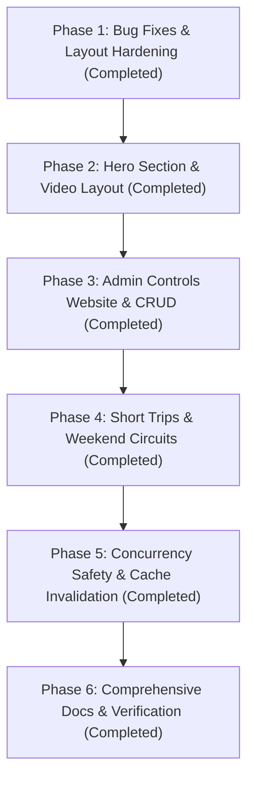

# OBTBS Gap Analysis & Architecture Evolution Plan

## 1. Executive Summary

This document performs an exhaustive audit of the existing `bus-booking-app` repository against the **Online Bus Ticket Booking System (OBTBS) Software Requirements Specification (SRS)** (`OBTBS.pdf`).

The current application provides a foundational MERN stack setup with basic bus listings, hardcoded seat layout generation, simulated immediate bookings, and an admin UI largely powered by mock data. This analysis outlines the architectural, data-model, security, and algorithmic gaps required to transform the codebase into an enterprise-grade, concurrency-safe, trip-centric bus reservation platform.

---

## 2. Core Architectural Paradigm Shift

| Feature Dimension | Current Repository Implementation | Target OBTBS SRS Architecture |
| :--- | :--- | :--- |
| **Domain Model** | **Bus-Centric**: Bus entity embeds routes (`origin`, `destination`), schedules (`departureTime`, `arrivalTime`), and base fare. | **Trip-Centric**: Bus represents physical vehicle with static layout; Route defines geographic trajectory; **Trip** represents a scheduled instance (`busId + routeId + travelDate + times`). |
| **Seat Management** | **Computed / Ephemeral**: `seatController` synthesizes layouts on the fly (`L1..`, `U1..`), hardcodes ladies seats `[3,4,7]`, and queries `Booking` documents to deduce availability. | **Stored & Indexed**: Buses own explicit `seatLayout` arrays. `SeatReservation` records hold atomic locks and booked states keyed by `(tripId, seatNumber)`. |
| **Seat Booking Safety** | **Unsafe (Read-then-Write)**: `bookingController.createBooking` checks for collisions via `Booking.findOne` before inserting, vulnerable to race conditions under concurrent load. | **ACID & Index-Guaranteed**: 2-phase seat locking inside MongoDB transactions (`session.withTransaction`) enforcing a compound unique index on `(tripId, seatNumber)` (E11000 conflict handling). |
| **Payment Flow** | **Simulated / Instant**: Automatically flags bookings as `confirmed` and `paid` upon form submission with `Math.random()` PNR. | **2-Step Verification**: `pending` booking -> Gateway order initiation (Razorpay / Mock) -> Idempotent backend verification / webhook signature check (`confirmPayment()`) -> confirmed ticket. |
| **Ticket Issuance** | Browser-only print view (`PrintableTicket.jsx`) reading React client memory. | Dedicated `Ticket` collection storing immutable snapshots + server-side PDF generation (`GET /api/tickets/:id/pdf`). |
| **Frontend State** | Heavy fallback to `mockData.js` and `mockAdminData.js` in `api.js` and `AdminContext`. | 100% real API integration with proper loading, error, conflict, and polling states. |

---

## 3. Data Model Gap Analysis

```
+--------------------------------------------------------------------------------------------------+
|                                    TARGET DATA MODEL ENTITIES                                    |
+--------------------------------------------------------------------------------------------------+
|  +--------------------+       +--------------------+       +--------------------+                |
|  |       Bus          |       |       Route        |       |       Pricing      |                |
|  | - busNumber (UQ)   |       | - source           |       | - busId / routeId  |                |
|  | - seatLayout[]     |       | - destination      |       | - tripId (opt)     |                |
|  | - type / category  |       | - boardingPoints[] |       | - seatType         |                |
|  | - amenities[]      |       | - droppingPoints[] |       | - basePrice + tax  |                |
|  +---------+----------+       +---------+----------+       +---------+----------+                |
|            |                            |                            |                           |
|            +--------------+  +----------+                            |                           |
|                           |  |                                       |                           |
|                           v  v                                       |                           |
|                    +---------------+                                 |                           |
|                    |     Trip      |<--------------------------------+                           |
|                    | - busId       |                                                             |
|                    | - routeId     |                                                             |
|                    | - travelDate  |                                                             |
|                    | - times       |                                                             |
|                    +-------+-------+                                                             |
|                            |                                                                     |
|            +---------------+---------------+                                                     |
|            |                               |                                                     |
|            v                               v                                                     |
|  +--------------------+         +--------------------+         +--------------------+            |
|  |  SeatReservation   |         |      Booking       |         |      Payment       |            |
|  | - tripId (UQ)      |         | - bookingId / PNR  |<------->| - gatewayPaymentId |            |
|  | - seatNumber (UQ)  |         | - status (pending) |         | - status           |            |
|  | - status (lock/bk) |         | - passengers[]     |         | - signature verify |            |
|  +--------------------+         +---------+----------+         +--------------------+            |
|                                           |                                                      |
|                                           v                                                      |
|                                 +--------------------+                                           |
|                                 |       Ticket       |                                           |
|                                 | - journey snapshot |                                           |
|                                 | - PDF printable    |                                           |
|                                 +--------------------+                                           |
+--------------------------------------------------------------------------------------------------+
```

### Detailed Entity Discrepancies

1. **`Bus`**:
   - *Current*: Stores `origin`, `destination`, `departureTime`, `arrivalTime`, and `fare`. Lacks stored physical layout.
   - *Required*: Remove route/schedule duplication. Add `seatLayout`: Array of `{ seatNumber: String, type: 'sleeper' | 'seater', position: 'lower' | 'upper', category: 'window' | 'aisle' | 'normal', isLadies: Boolean }`.
2. **`Route`**:
   - *Current*: Basic origin/destination fields without formal boarding/dropping stops structure.
   - *Required*: Explicit `departurePoint`, `arrivalPoint`, `boardingPoints: [{ name, time, landmark }]`, `droppingPoints: [{ name, time, landmark }]`, `distanceKm`, `durationMinutes`, and `status`.
3. **`Trip` (New Entity)**:
   - *Current*: Relies on basic `BusSchedule` model (`busId, journeyDate`).
   - *Required*: Full `Trip` entity linking `busId`, `routeId`, `travelDate`, `departureTime`, `arrivalTime`, boarding/dropping locations, and status (`scheduled`, `active`, `completed`, `cancelled`). Compound unique index on `(busId, travelDate, departureTime)`.
4. **`Pricing` (New Entity)**:
   - *Current*: Single `bus.fare` scalar.
   - *Required*: Dynamic resolution hierarchy: `Trip-specific > Route + Bus > Route default > Bus default`. Supports seat-type multipliers (e.g. Sleeper Upper vs Lower).
5. **`SeatReservation` (Replaces `Seat`)**:
   - *Current*: Holds temporary `held` status keyed by `(busId, journeyDate, seatNumber)`. Does not store booked status (booked status is inferred from `Booking`).
   - *Required*: Strict compound unique index on `(tripId, seatNumber)`. Supports statuses `locked` (with `lockExpiresAt`) and `booked`. Automatic lock cleanup via TTL / background worker.
6. **`Booking`**:
   - *Current*: `bookingReference` generated with `Math.random()`, status immediately `confirmed`.
   - *Required*: UUID/crypto-random PNR, lifecycle states (`pending`, `confirmed`, `failed`, `expired`, `cancelled`), reference to `tripId`, server-audited price breakdown.
7. **`Payment`**:
   - *Current*: Fake record created synchronously.
   - *Required*: Support real/mock gateway (Razorpay order ID, payment ID, signature verification), idempotency index on `gatewayPaymentId`, and `refund_required` state.
8. **`Ticket` (New Entity)**:
   - *Current*: None.
   - *Required*: Immutable snapshot of journey, bus, passenger, and pricing details. Server-side PDF generation endpoint.

---

## 4. Concurrency & Seat Locking Algorithm

### The Two-User Collision Scenario (SRS §7.1 - §7.6)
When User A and User B concurrently attempt to reserve seat `A1` on Trip `T101`:
1. Client requests `POST /api/trips/:tripId/locks` with `['A1']`.
2. Backend initiates a Mongoose session transaction (`session.withTransaction`).
3. Expired locks for `('T101', 'A1')` (`lockExpiresAt < Date.now()`) are purged or overwritten.
4. Database insert is attempted on `SeatReservation`:
   - User A's thread arrives first -> Insert succeeds -> `lockExpiresAt` set to `now + 8 minutes`.
   - User B's thread arrives second -> MongoDB Compound Unique Index `(tripId: 1, seatNumber: 1)` trips -> Throws `E11000 duplicate key error`.
5. Backend catches `11000` inside the transaction, aborts, and returns **HTTP 409 Conflict** with `{ conflictingSeats: ['A1'] }`.
6. User B's frontend receives 409, marks `A1` as locked/unavailable, and displays a user-friendly notification without breaking session state.

---

## 5. Frontend & UI/UX Gaps

1. **Mock Data Reliance**:
   - `frontend/src/services/api.js` falls back to `MOCK_BUSES` and `POPULAR_ROUTES` in `catch` blocks.
   - `frontend/src/admin/context/AdminContext.jsx` initializes with `mockAdminData.js`.
   - *Action*: Remove mock fallbacks or gate them behind `VITE_USE_MOCKS=true`.
2. **Seat Selection Component**:
   - *Current*: Hardcoded lower/upper layout derived from client loops.
   - *Required*: Dynamically render layout from `trip.busId.seatLayout`. Represent 4 distinct states: Available, Selected, Locked (with countdown timer), and Booked.
3. **Ticket Presentation**:
   - *Current*: React print preview only.
   - *Required*: Server-side PDF download (`/api/tickets/:id/pdf`) using PDFKit or HTML-to-PDF pipeline.
4. **Admin Dashboard**:
   - Wire all SRS modules: Buses, Routes, Trips/Schedules, Seat Configuration, Pricing, Bookings, Payments, Customers, and Reports to real endpoints.

---

## 6. Phased Implementation Roadmap & Delivery Status



- **Phase 1: Bug Fixes & Layout Hardening (Completed in `31fec0f`)**:
  - Fixed `/admin/buses` table rendering by updating table columns to match current `Bus` model schema.
  - Eliminated silent fallback masking errors in `AdminContext.jsx`; added clear loading and error retry states.
  - Resolved sticky navbar layout clipping globally on Admin pages and `/destinations`.
  - Unified branding to **YatraBus** throughout admin sidebar, breadcrumbs, footers, page titles, and PDF tickets.
  - Replaced hardcoded footer server badge with live Redis + MongoDB probe from `GET /api/health`.
  - Redirected admin accounts to `/admin` dashboard instead of displaying customer profile.
  - Replaced fake data on customer `/dashboard` with authentic MongoDB collections (`SavedPassenger`, `JournalEntry`, upcoming/completed trip history).
  - Rebuilt `/popular-trips` as popular bus corridors and preserved bus operator identities in search results.

- **Phase 2: Hero Section & Video Verification (Completed in `bd2cb09`)**:
  - Redesigned `Home.jsx` hero layout: anchored text content low (`items-end pb-12`) so background video is clearly visible above search form.
  - Fully responsive across 360px, 768px, and 1280px without search form overlap.
  - Removed "Watch Story Video" modal, state, and dead code.
  - Handled `prefers-reduced-motion` with static poster fallback.

- **Phase 3: Admin Controls Website (Completed in `f2eb366`)**:
  - Implemented interactive visual seat layout designer with brush tool (regular, sleeper, ladies-only, blocked) and lower/upper deck switcher.
  - Built Automated Recurring Trip Schedule Generator (`POST /api/admin/trips/recurrence`) with vehicle conflict prevention.
  - Built Multi-Tier Dynamic Pricing engine with live simulator (`POST /api/admin/pricing/preview`) calculating weekend, festive, last-minute, and berth multipliers.
  - Added operational seat reassignment (`POST /api/admin/bookings/:id/change-seat`) and passenger wallet adjustment (`PATCH /api/admin/passengers/:id/wallet`).
  - Added comprehensive system audit logs (`GET /api/admin/audit-logs`) tracking admin actions with before/after diffs.
  - Configured multipart file uploads (`POST /api/admin/upload`) for images up to 5MB.
  - Created automated passenger delay and cancellation alerts (`TripNotification`).

- **Phase 4: Short Trips & Weekend Circuits (Completed in `f2eb366`)**:
  - Developed full-stack module (`TripPackage` model, controller, routes, seed data).
  - Built public customer page `/short-trips` with category filtering (Pilgrim, Konkan, Leisure, Monsoon, Heritage) and day-by-day modal itineraries.
  - Built admin management page `/admin/packages` with complete CRUD and itinerary builder.
  - Integrated dynamic short-trips tabs into `Home.jsx` backed by `GET /api/packages`.
  - Seeded 8 authentic Indian circuits (Digha, Mandarmani, Ajmer/Pushkar, Konkan coast, etc.).

- **Phase 5: Concurrency Safety & Cache Invalidation (Completed & Hardened)**:
  - Added future confirmed bookings safety lock preventing seat layout modification or bus deletion if future confirmed bookings exist.
  - Hardened atomic seat locking with MongoDB transactions and compound unique index `{ tripId: 1, seatNumber: 1 }`.
  - Verified 20-parallel lock requests test: exactly 1 request wins, 19 receive HTTP 409 Conflict without duplicate reservations.
  - Configured automatic Redis cache invalidation on all admin write mutations.

- **Phase 6: Comprehensive Documentation & Verification (Completed)**:
  - Updated `API_DOCUMENTATION.md` with complete schemas for all public and admin endpoints.
  - Updated `DATABASE_SCHEMA.md` with full Mongoose schemas, ER diagrams, and indexes.
  - Updated `README.md` with running instructions, seed credentials, and test commands.
  - Verified 100% test pass rate (64 backend tests, 23 frontend tests, clean Vite production build).

---

## 7. SRS & Master Fix Requirements Compliance Matrix

| Requirement / SRS Section | Description | Status | Implementation Details |
| :--- | :--- | :--- | :--- |
| **SRS §5.1: Admin Dashboard** | Fleet, booking, route, and revenue KPI overview | **100% Complete** | Real MongoDB aggregations via `/api/admin/dashboard` |
| **SRS §5.2: Bus Fleet Management** | Fleet CRUD & capacity tracking | **100% Complete** | Real DB CRUD via `/api/admin/buses` with safety guards |
| **SRS §5.3: Route Management** | Boarding/dropping stops & distance | **100% Complete** | Real DB CRUD via `/api/admin/routes` |
| **SRS §5.4: Schedule Management** | Daily & recurring trip departures | **100% Complete** | Recurrence generator via `/api/admin/trips/recurrence` |
| **SRS §5.5: Seat Configuration** | Interactive visual seat layout editor | **100% Complete** | Deck & seat type brush editor via `/api/admin/buses/:id/layout` |
| **SRS §5.6: Pricing Management** | Multi-tier rules & dynamic simulator | **100% Complete** | Multipliers & live preview via `/api/admin/pricing/preview` |
| **SRS §5.7: Booking Management** | Audit, cancellations, seat reassignments | **100% Complete** | Real DB bookings, refund triggers, and operational seat changes |
| **SRS §5.8: Payment Management** | Transactions, refunds & gateway audit | **100% Complete** | Razorpay / Mock gateway verification & refund triggers |
| **SRS §5.9: Customer Management** | Profile audit, status toggles & wallet credit | **100% Complete** | Real passenger roster & wallet adjustment with audit log |
| **SRS §5.10: Reports & Analytics** | Timeframe financial analytics (7D, 30D, YTD)| **100% Complete** | Aggregation pipelines via `/api/admin/reports` |
| **SRS §6.1-§6.3: Bus Search** | Origin, destination, date & operator filtering | **100% Complete** | Canonical `/api/trips` search with operator preservation |
| **SRS §6.4-§6.5: Seat Availability**| Real-time seat map & temporary locking | **100% Complete** | 8-minute TTL locks via `SeatReservation` |
| **SRS §6.6: Booking & Payment** | Server pricing audit & 2-step verification | **100% Complete** | Server price recomputation & idempotent payment verification |
| **SRS §6.7: Digital Ticket & PDF** | Printable digital ticket & server PDF | **100% Complete** | Server-side PDFKit generation via `/api/tickets/:id/pdf` |
| **SRS §6.10: Customer History** | Personal bookings, saved passengers, journal | **100% Complete** | Real MongoDB collections on `/dashboard` |
| **Master Fix: Single Source of Truth**| No hardcoded customer content | **100% Complete** | All content backed by MongoDB and Redis |
