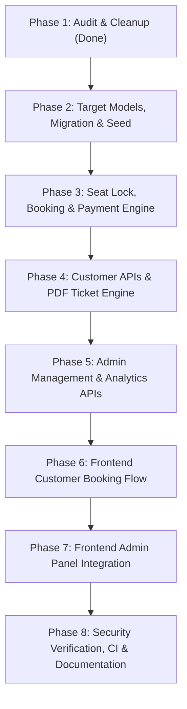

# OBTBS Gap Analysis & Architecture Evolution Plan

## 1. Executive Summary

This document performs an exhaustive audit of the existing `bus-booking-app` repository against the **Online Bus Ticket Booking System (OBTBS) Software Requirements Specification (SRS)** (`OBTBS.pdf`).

The current application provides a foundational MERN stack setup with basic bus listings, hardcoded seat layout generation, simulated immediate bookings, and an admin UI largely powered by mock data. This analysis outlines the architectural, data-model, security, and algorithmic gaps required to transform the codebase into an enterprise-grade, concurrency-safe, trip-centric bus reservation platform.

---

## 2. Core Architectural Paradigm Shift

| Feature Dimension | Current Repository Implementation | Target OBTBS SRS Architecture |
| :--- | :--- | :--- |
| **Domain Model** | **Bus-Centric**: Bus entity embeds routes (`origin`, `destination`), schedules (`departureTime`, `arrivalTime`), and base fare. | **Trip-Centric**: Bus represents physical vehicle with static layout; Route defines geographic trajectory; **Trip** represents a scheduled instance (`busId + routeId + travelDate + times`). |
| **Seat Management** | **Computed / Ephemeral**: `seatController` synthesizes layouts on the fly (`L1..`, `U1..`), hardcodes ladies seats `[3,4,7]`, and queries `Booking` documents to deduce availability. | **Stored & Indexed**: Buses own explicit `seatLayout` arrays. `SeatReservation` records hold atomic locks and booked states keyed by `(tripId, seatNumber)`. |
| **Seat Booking Safety** | **Unsafe (Read-then-Write)**: `bookingController.createBooking` checks for collisions via `Booking.findOne` before inserting, vulnerable to race conditions under concurrent load. | **ACID & Index-Guaranteed**: 2-phase seat locking inside MongoDB transactions (`session.withTransaction`) enforcing a compound unique index on `(tripId, seatNumber)` (E11000 conflict handling). |
| **Payment Flow** | **Simulated / Instant**: Automatically flags bookings as `confirmed` and `paid` upon form submission with `Math.random()` PNR. | **2-Step Verification**: `pending` booking -> Gateway order initiation (Razorpay / Mock) -> Idempotent backend verification / webhook signature check (`confirmPayment()`) -> confirmed ticket. |
| **Ticket Issuance** | Browser-only print view (`PrintableTicket.jsx`) reading React client memory. | Dedicated `Ticket` collection storing immutable snapshots + server-side PDF generation (`GET /api/tickets/:id/pdf`). |
| **Frontend State** | Heavy fallback to `mockData.js` and `mockAdminData.js` in `api.js` and `AdminContext`. | 100% real API integration with proper loading, error, conflict, and polling states. |

---

## 3. Data Model Gap Analysis

```
+--------------------------------------------------------------------------------------------------+
|                                    TARGET DATA MODEL ENTITIES                                    |
+--------------------------------------------------------------------------------------------------+
|  +--------------------+       +--------------------+       +--------------------+                |
|  |       Bus          |       |       Route        |       |       Pricing      |                |
|  | - busNumber (UQ)   |       | - source           |       | - busId / routeId  |                |
|  | - seatLayout[]     |       | - destination      |       | - tripId (opt)     |                |
|  | - type / category  |       | - boardingPoints[] |       | - seatType         |                |
|  | - amenities[]      |       | - droppingPoints[] |       | - basePrice + tax  |                |
|  +---------+----------+       +---------+----------+       +---------+----------+                |
|            |                            |                            |                           |
|            +--------------+  +----------+                            |                           |
|                           |  |                                       |                           |
|                           v  v                                       |                           |
|                    +---------------+                                 |                           |
|                    |     Trip      |<--------------------------------+                           |
|                    | - busId       |                                                             |
|                    | - routeId     |                                                             |
|                    | - travelDate  |                                                             |
|                    | - times       |                                                             |
|                    +-------+-------+                                                             |
|                            |                                                                     |
|            +---------------+---------------+                                                     |
|            |                               |                                                     |
|            v                               v                                                     |
|  +--------------------+         +--------------------+         +--------------------+            |
|  |  SeatReservation   |         |      Booking       |         |      Payment       |            |
|  | - tripId (UQ)      |         | - bookingId / PNR  |<------->| - gatewayPaymentId |            |
|  | - seatNumber (UQ)  |         | - status (pending) |         | - status           |            |
|  | - status (lock/bk) |         | - passengers[]     |         | - signature verify |            |
|  +--------------------+         +---------+----------+         +--------------------+            |
|                                           |                                                      |
|                                           v                                                      |
|                                 +--------------------+                                           |
|                                 |       Ticket       |                                           |
|                                 | - journey snapshot |                                           |
|                                 | - PDF printable    |                                           |
|                                 +--------------------+                                           |
+--------------------------------------------------------------------------------------------------+
```

### Detailed Entity Discrepancies

1. **`Bus`**:
   - *Current*: Stores `origin`, `destination`, `departureTime`, `arrivalTime`, and `fare`. Lacks stored physical layout.
   - *Required*: Remove route/schedule duplication. Add `seatLayout`: Array of `{ seatNumber: String, type: 'sleeper' | 'seater', position: 'lower' | 'upper', category: 'window' | 'aisle' | 'normal', isLadies: Boolean }`.
2. **`Route`**:
   - *Current*: Basic origin/destination fields without formal boarding/dropping stops structure.
   - *Required*: Explicit `departurePoint`, `arrivalPoint`, `boardingPoints: [{ name, time, landmark }]`, `droppingPoints: [{ name, time, landmark }]`, `distanceKm`, `durationMinutes`, and `status`.
3. **`Trip` (New Entity)**:
   - *Current*: Relies on basic `BusSchedule` model (`busId, journeyDate`).
   - *Required*: Full `Trip` entity linking `busId`, `routeId`, `travelDate`, `departureTime`, `arrivalTime`, boarding/dropping locations, and status (`scheduled`, `active`, `completed`, `cancelled`). Compound unique index on `(busId, travelDate, departureTime)`.
4. **`Pricing` (New Entity)**:
   - *Current*: Single `bus.fare` scalar.
   - *Required*: Dynamic resolution hierarchy: `Trip-specific > Route + Bus > Route default > Bus default`. Supports seat-type multipliers (e.g. Sleeper Upper vs Lower).
5. **`SeatReservation` (Replaces `Seat`)**:
   - *Current*: Holds temporary `held` status keyed by `(busId, journeyDate, seatNumber)`. Does not store booked status (booked status is inferred from `Booking`).
   - *Required*: Strict compound unique index on `(tripId, seatNumber)`. Supports statuses `locked` (with `lockExpiresAt`) and `booked`. Automatic lock cleanup via TTL / background worker.
6. **`Booking`**:
   - *Current*: `bookingReference` generated with `Math.random()`, status immediately `confirmed`.
   - *Required*: UUID/crypto-random PNR, lifecycle states (`pending`, `confirmed`, `failed`, `expired`, `cancelled`), reference to `tripId`, server-audited price breakdown.
7. **`Payment`**:
   - *Current*: Fake record created synchronously.
   - *Required*: Support real/mock gateway (Razorpay order ID, payment ID, signature verification), idempotency index on `gatewayPaymentId`, and `refund_required` state.
8. **`Ticket` (New Entity)**:
   - *Current*: None.
   - *Required*: Immutable snapshot of journey, bus, passenger, and pricing details. Server-side PDF generation endpoint.

---

## 4. Concurrency & Seat Locking Algorithm

### The Two-User Collision Scenario (SRS §7.1 - §7.6)
When User A and User B concurrently attempt to reserve seat `A1` on Trip `T101`:
1. Client requests `POST /api/trips/:tripId/locks` with `['A1']`.
2. Backend initiates a Mongoose session transaction (`session.withTransaction`).
3. Expired locks for `('T101', 'A1')` (`lockExpiresAt < Date.now()`) are purged or overwritten.
4. Database insert is attempted on `SeatReservation`:
   - User A's thread arrives first -> Insert succeeds -> `lockExpiresAt` set to `now + 8 minutes`.
   - User B's thread arrives second -> MongoDB Compound Unique Index `(tripId: 1, seatNumber: 1)` trips -> Throws `E11000 duplicate key error`.
5. Backend catches `11000` inside the transaction, aborts, and returns **HTTP 409 Conflict** with `{ conflictingSeats: ['A1'] }`.
6. User B's frontend receives 409, marks `A1` as locked/unavailable, and displays a user-friendly notification without breaking session state.

---

## 5. Frontend & UI/UX Gaps

1. **Mock Data Reliance**:
   - `frontend/src/services/api.js` falls back to `MOCK_BUSES` and `POPULAR_ROUTES` in `catch` blocks.
   - `frontend/src/admin/context/AdminContext.jsx` initializes with `mockAdminData.js`.
   - *Action*: Remove mock fallbacks or gate them behind `VITE_USE_MOCKS=true`.
2. **Seat Selection Component**:
   - *Current*: Hardcoded lower/upper layout derived from client loops.
   - *Required*: Dynamically render layout from `trip.busId.seatLayout`. Represent 4 distinct states: Available, Selected, Locked (with countdown timer), and Booked.
3. **Ticket Presentation**:
   - *Current*: React print preview only.
   - *Required*: Server-side PDF download (`/api/tickets/:id/pdf`) using PDFKit or HTML-to-PDF pipeline.
4. **Admin Dashboard**:
   - Wire all SRS modules: Buses, Routes, Trips/Schedules, Seat Configuration, Pricing, Bookings, Payments, Customers, and Reports to real endpoints.

---

## 6. Phased Implementation Roadmap



- **Phase 1**: Audit, gap analysis, and deletion of stray `.ts` and duplicate config files.
- **Phase 2**: Implement `Trip`, `Pricing`, `SeatReservation`, `Ticket` models; update `Bus`, `Route`, `Booking`, `Payment`; write migration script `backend/src/scripts/migrate-to-trips.js` and enrich `seed.js`.
- **Phase 3**: Implement atomic seat lock engine, transaction-based booking workflow, Razorpay/Mock gateway adapter, and concurrency test suite.
- **Phase 4**: Implement customer search, trip details, digital ticket, and server-side PDF generator.
- **Phase 5**: Implement admin trip scheduler, bus layout editor, pricing rules, payment monitor, and analytical reports.
- **Phase 6**: Upgrade frontend customer flow (real API, dynamic seat layout, countdown timer, Razorpay checkout, PDF download).
- **Phase 7**: Connect admin panel to backend APIs; retire mock data.
- **Phase 8**: Update documentation (`API_DOCUMENTATION.md`, `DATABASE_SCHEMA.md`, `README.md`), run full regression test suites.
