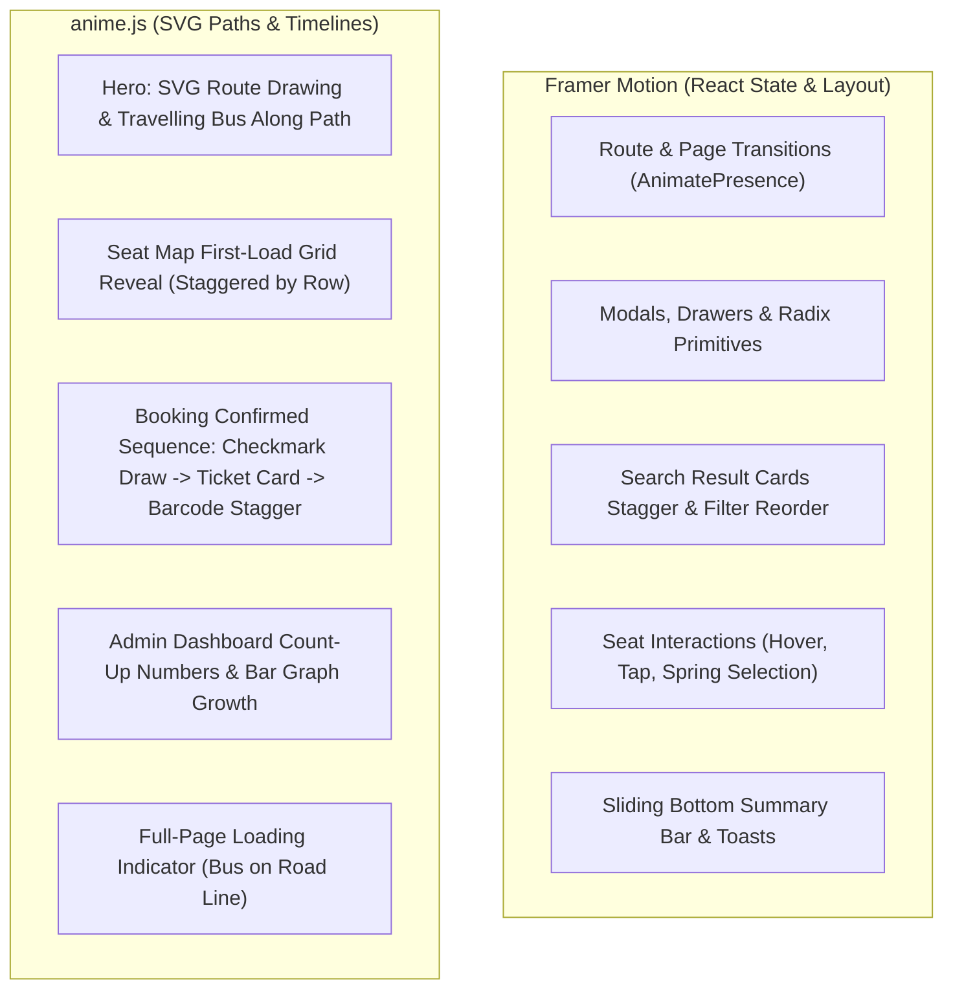

# Motion Architecture & Animation Style Guide

## Bus Booking App — Online Bus Ticket Booking System

This document establishes the strict division of labor, performance rules, and design tokens for UI motion across the **Bus Booking App**.

---

## 1. Strict Division of Labour

To prevent library conflicts and keep bundle execution lean:
- **Never animate the same DOM/SVG element with both Framer Motion and anime.js.**
- **Framer Motion** owns all state-driven React UI motion and layout animations.
- **anime.js (v4/v3)** owns timeline-based SVG path animations and complex multi-stage coordinate choreography.



---

## 2. Rules & Non-Negotiables

1. **Strict Lifecycle Cleanup**:
   All anime.js instances must be initialized within `useEffect` or `useLayoutEffect` and return a cleanup callback that pauses and reverts the animation (`animation.pause()`). This guarantees safety under React 18/19 StrictMode double-mounting.
2. **Accessible Reduced-Motion (`prefers-reduced-motion`)**:
   - Framer Motion: Wrapped inside `<MotionConfig reducedMotion="user">`.
   - anime.js: Checked via `window.matchMedia('(prefers-reduced-motion: reduce)')`. If enabled, duration is set to `0` or the timeline instantly seeks to completion.
3. **Hardware Acceleration**:
   - Animate **only** `transform` (`scale`, `translate3d`, `rotate`) and `opacity`.
   - Never animate `width`, `height`, `top`, `left`, `margin`, or `padding` to prevent browser layout reflows and jank.
4. **Duration Budgets**:
   - Micro-interactions (buttons, seat clicks, badges): `< 200 ms`.
   - Component reveals (cards, drawers, modals): `< 300 ms`.
   - Page transitions: `< 400 ms`.

---

## 3. Reusable `useAnime` Hook Specification

Location: `frontend/src/hooks/useAnime.ts`
```typescript
import { useEffect, useRef } from 'react';
import anime from 'animejs';

export function useAnime<T extends HTMLElement | SVGElement>(
  animator: (target: T, isReduced: boolean) => anime.AnimeInstance | undefined,
  deps: React.DependencyList = []
) {
  const ref = useRef<T | null>(null);

  useEffect(() => {
    if (!ref.current) return;
    const isReduced = window.matchMedia('(prefers-reduced-motion: reduce)').matches;
    const instance = animator(ref.current, isReduced);

    return () => {
      if (instance) {
        instance.pause();
      }
    };
  }, deps);

  return ref;
}
```

---

## 4. Motion Design Tokens (`lib/motion/config.ts`)

```typescript
export const MOTION_TOKENS = {
  duration: {
    instant: 0.1,
    fast: 0.2,
    normal: 0.3,
    slow: 0.5,
  },
  easing: {
    standard: [0.2, 0, 0, 1], // ease-out
    emphasized: [0.05, 0.7, 0.1, 1],
    springDefault: { type: 'spring', stiffness: 350, damping: 25 },
    springGentle: { type: 'spring', stiffness: 200, damping: 20 },
    springBouncy: { type: 'spring', stiffness: 450, damping: 15 },
  },
  stagger: {
    fast: 0.04,
    medium: 0.08,
  }
};
```
