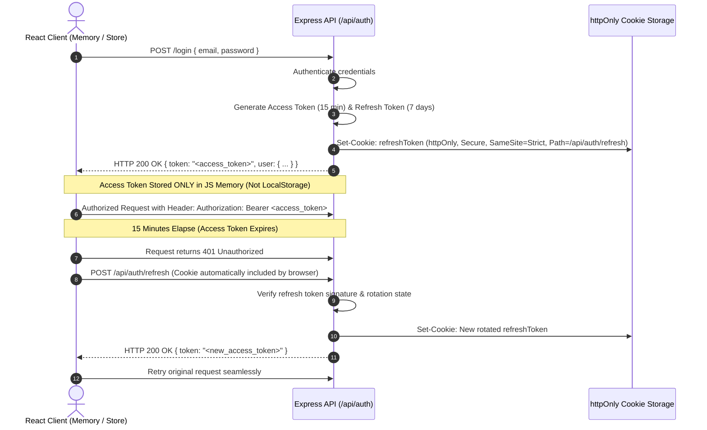

# Security Architecture & OWASP Top 10 Review

## Bus Booking App — Online Bus Ticket Booking System

This document outlines the security controls, authentication safeguards, and OWASP Top 10 defenses engineered into the **Bus Booking App**.

---

## 1. OWASP Top 10 Compliance Matrix

| OWASP Vulnerability | Risk Level | Architectural Countermeasure | Verification |
| :--- | :--- | :--- | :--- |
| **A01: Broken Access Control** | High | Role-based middleware (`authMiddleware`, `adminMiddleware`). Strict data ownership checks: `userId` matched on booking and profile endpoints. Normal users cannot access `/api/admin/*`. | Tested via unit/integration tests with regular user token on admin routes. |
| **A02: Cryptographic Failures** | Critical | Passwords hashed using `bcryptjs` with salt rounds = 10. Dual-token JWT (15-min access token + 7-day refresh token in `httpOnly`, `Secure`, `SameSite=Strict` cookie). Zero secrets committed to git. | Automated static code analysis & `.gitignore` audits. |
| **A03: Injection (NoSQL / SQL)** | High | `express-mongo-sanitize` strips out `$` and `.` operators from `req.body`, `req.query`, and `req.params`. Strict typed Mongoose schemas reject raw injection payloads. | Penetration test attempts using `{ $gt: "" }` in auth payloads. |
| **A04: Insecure Design** | High | Concurrency-safe seat reservation using MongoDB unique partial index `{ tripId: 1, "passengers.seatNumber": 1 }` inside ACID transactions. Double-booking is impossible at the database level. | Concurrent double-booking integration test. |
| **A05: Security Misconfiguration** | Medium | Secure HTTP headers via `helmet`. CORS restricted strictly to `CLIENT_URL`. Error messages sanitized (no stack traces in production). | Headers inspection via curl/Postman. |
| **A06: Vulnerable & Outdated Components** | Medium | Regular `npm audit` and dependency pinning. Strict semantic versioning. | GitHub Dependabot & CI scanning. |
| **A07: Identification & Auth Failures** | High | Strict rate limiting on `/api/auth/*` (5 attempts per minute per IP) to prevent brute-force attacks. Generic login error messages ("Invalid credentials"). | Brute-force rate limit test. |
| **A08: Software & Data Integrity Failures** | Medium | Zod schema validation on all inputs before business logic execution. Idempotency key tracking prevents double submits. | Idempotency header integration tests. |
| **A09: Security Logging & Monitoring Failures** | Medium | Structured logging using `pino` and `pino-http` with unique `x-request-id` attached to every request. Sensitive fields (`password`, `token`) masked in logs. | Pino output inspection. |
| **A10: Server-Side Request Forgery (SSRF)** | Low | Zero outgoing webhooks or arbitrary URL fetching performed by the backend. | Architectural boundary. |

---

## 2. Token Lifecycle & CSRF Defense

### CSRF Protection:
- Refresh cookies are configured with `SameSite=Strict` (or `Lax` across trusted subdomains) and restricted strictly to `/api/auth/refresh`.
- State-modifying requests (`POST`, `PUT`, `DELETE`) require the `Authorization: Bearer <token>` header, which browsers never send automatically from cross-site scripts.
