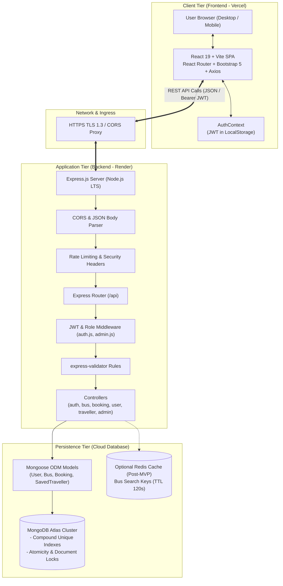
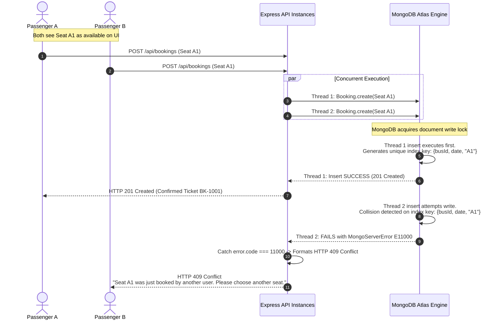
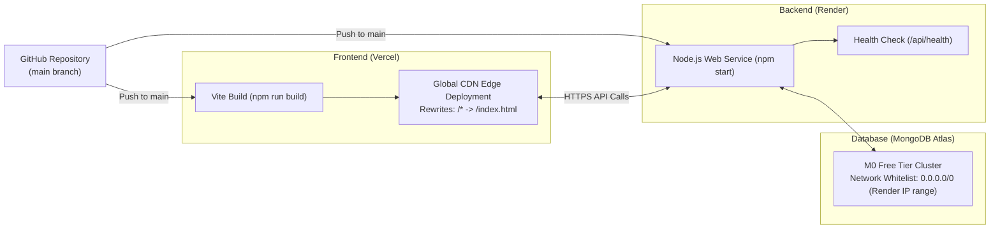

# Technical Requirements Document (TRD)

## Bus Booking App — Online Bus Ticket Booking System

| Document Version | Status | Target Release | Stack |
| :--- | :--- | :--- | :--- |
| 1.0.0 | Ready for Review | 4-Week Academic MVP | React + Vite, Bootstrap 5, Express.js, Node.js, MongoDB + Mongoose |

---

## 1. High-Level System Architecture

The **Bus Booking App** follows a decoupled client-server architecture. The frontend is a Single Page Application (SPA) built with React and Vite, styled with Bootstrap 5, and hosted on **Vercel**. The backend is a stateless RESTful API built with Node.js and Express.js, hosted on **Render**, communicating with a managed **MongoDB Atlas** cloud cluster.



---

## 2. Component Architecture & Folder Responsibilities

The codebase enforces strict separation of concerns across presentation, routing, business logic, validation, and data persistence.

### 2.1 Backend Folder Responsibilities (`backend/`)

```text
backend/
├── config/
│   └── db.js               # MongoDB connection lifecycle using Mongoose
├── controllers/
│   ├── authController.js    # Register, login, current user verification
│   ├── busController.js     # Public bus search, bus details, seat occupancy
│   ├── bookingController.js # Checkout, seat reservation, my-bookings history
│   ├── travellerController.js# Saved traveller CRUD
│   └── adminController.js   # Admin bus CRUD, all bookings audit
├── middleware/
│   ├── authMiddleware.js    # Verifies JWT Bearer token & attaches req.user
│   ├── adminMiddleware.js   # Enforces req.user.role === 'admin'
│   ├── errorMiddleware.js   # Global error handling and formatted JSON envelopes
│   └── validator.js         # express-validator result checking helper
├── models/
│   ├── User.js              # User schema with bcrypt password hashing
│   ├── Bus.js               # Bus fleet, schedule, fare, routes schema
│   ├── Booking.js           # Booking schema with concurrency compound unique index
│   └── SavedTraveller.js    # Frequent passenger profiles schema
├── routes/
│   ├── authRoutes.js        # /api/auth endpoints
│   ├── busRoutes.js         # /api/buses endpoints
│   ├── bookingRoutes.js     # /api/bookings endpoints
│   ├── travellerRoutes.js   # /api/travellers endpoints
│   └── adminRoutes.js       # /api/admin endpoints
├── scripts/
│   └── seed.js              # Database seeding script with realistic demo data
├── utils/
│   ├── generateToken.js     # Signs JWT with userId and role
│   └── constants.js         # Bus types, seat capacity, status enums
└── server.js                # Express app initialization, middleware mounting, port binding
```

### 2.2 Frontend Folder Responsibilities (`frontend/src/`)

```text
frontend/src/
├── assets/                  # Static brand assets, logos, and hero banners
├── components/              # Reusable UI widgets
│   ├── Navbar.jsx           # Global navigation with role-aware action links
│   ├── Footer.jsx           # Consistent footer with college project credentials
│   ├── BusCard.jsx          # Bus search result summary card
│   ├── SeatMap.jsx          # Interactive 2x2 seat grid with live state toggling
│   ├── ProtectedRoute.jsx   # Route guard redirecting unauthenticated users to /login
│   ├── AdminRoute.jsx       # Route guard redirecting non-admins
│   ├── AlertBanner.jsx      # Reusable Bootstrap alert for success/error alerts
│   └── LoadingSpinner.jsx   # Centered spinner for async state
├── context/
│   └── AuthContext.jsx      # React Context managing auth state, token, login, logout
├── pages/                   # Top-level view screens mapped to React Router
│   ├── Home.jsx             # Hero search form and featured travel destinations
│   ├── SearchResults.jsx    # Filterable list of buses matching query
│   ├── BusDetails.jsx       # Bus schedule, amenities, and route info
│   ├── SeatSelection.jsx    # Visual seat selection screen with live price counter
│   ├── PassengerDetails.jsx # Form for passenger names/ages + saved traveller autofill
│   ├── BookingSummary.jsx   # Pre-checkout confirmation summary
│   ├── Ticket.jsx           # Digital ticket view with unique PNR reference
│   ├── MyBookings.jsx       # Historical list of bookings placed by user
│   ├── Profile.jsx          # Profile details and saved travellers management
│   ├── Login.jsx            # Sign in form
│   ├── Register.jsx         # Sign up form
│   └── admin/               # Restricted administration pages
│       ├── AdminDashboard.jsx # Quick links, fleet statistics (Post-MVP)
│       ├── ManageBuses.jsx    # Table of buses with Add, Edit, Delete modals
│       └── AllBookings.jsx    # Paginated master bookings table
├── services/                # Axios API communication modules
│   ├── api.js               # Central Axios instance with JWT request interceptor
│   ├── authService.js       # Login, register, profile API calls
│   ├── busService.js        # Bus search and seat occupancy calls
│   ├── bookingService.js    # Create booking and booking history calls
│   └── adminService.js      # Admin fleet and bookings calls
├── App.jsx                  # Main application router and context providers
└── main.jsx                 # Vite application entry point and Bootstrap CSS bundle
```

---

## 3. Authentication & Authorization Design

### 3.1 JWT Token Lifecycle & Security

```mermaid
sequenceDiagram
    autonumber
    actor User as User Browser
    participant React as React Frontend (AuthContext)
    participant API as Express API (/api/auth)
    participant DB as MongoDB Atlas

    User->>React: Submits Email & Password
    React->>API: POST /api/auth/login { email, password }
    API->>DB: User.findOne({ email })
    DB-->>API: Returns user record with hashed password
    API->>API: bcrypt.compare(password, user.password)
    alt Invalid Credentials
        API-->>React: HTTP 401 Unauthorized { success: false, message: "Invalid credentials" }
        React-->>User: Display error banner
    else Valid Credentials
        API->>API: jwt.sign({ id: user._id, role: user.role }, JWT_SECRET, { expiresIn: '24h' })
        API-->>React: HTTP 200 OK { success: true, token, user: { id, name, email, role } }
        React->>React: Store token & user in localStorage; update AuthContext
        React-->>User: Redirect to requested page (or /)
    end

    Note over User,API: Subsequent Authenticated Requests
    React->>API: GET /api/bookings/my-bookings (Header: Authorization: Bearer <token>)
    API->>API: authMiddleware verifies signature & expiration
    alt Token Expired or Invalid
        API-->>React: HTTP 401 Unauthorized { success: false, message: "Token expired or invalid" }
        React->>React: Clear localStorage, reset AuthContext, redirect to /login
    else Token Valid
        API->>DB: Fetch user bookings
        DB-->>API: Return bookings
        API-->>React: HTTP 200 OK with booking data
    end
```

### 3.2 Password Hashing
- Passwords are encrypted before persisting using `bcryptjs` with **10 salt rounds**.
- Passwords are never returned in API payloads (`select: '-password'` in Mongoose queries).

### 3.3 Authorization Middleware Implementation Pattern
1. `authMiddleware`: Extracts the `Bearer <token>` from the HTTP `Authorization` header, decodes the payload using `jwt.verify()`, and attaches `{ id, role }` to `req.user`. If absent or malformed, responds with `401 Unauthorized`.
2. `adminMiddleware`: Runs immediately after `authMiddleware`. Verifies that `req.user.role === 'admin'`. If the user is a standard passenger, responds with `403 Forbidden`.

---

## 4. Seat-Booking Concurrency Strategy

Preventing duplicate seat bookings is the paramount technical invariant of this application. Relying exclusively on application-level checks (e.g. `if (seatIsTaken)`) introduces race conditions under concurrent requests.

### 4.1 The Concurrency Threat Model
Two users (`User A` and `User B`) select seat `"A1"` on bus `654a1...` for journey date `2026-11-20`. Both click "Confirm Booking" within the same 50-millisecond window.



### 4.2 Database-Level Concurrency Invariant
In `Booking.js`, the schema defines:
```javascript
bookingSchema.index(
  {
    busId: 1,
    journeyDate: 1,
    "passengers.seatNumber": 1
  },
  {
    unique: true,
    partialFilterExpression: { bookingStatus: "confirmed" },
    name: "unique_bus_date_seat_confirmed"
  }
);
```

### 4.3 Error Handling in Controller
```javascript
try {
  const newBooking = await Booking.create(bookingPayload);
  return res.status(201).json({
    success: true,
    message: 'Booking confirmed successfully',
    data: newBooking
  });
} catch (error) {
  if (error.code === 11000) {
    return res.status(409).json({
      success: false,
      message: 'One or more selected seats have already been booked by another passenger. Please select another seat.',
      errors: [{ field: 'seats', message: 'Seat collision detected' }]
    });
  }
  next(error);
}
```

---

## 5. Input Validation Strategy

Validation occurs at two concentric layers:
1. **Client-Side (React)**: Immediate UI feedback using HTML5 attributes and form validation states before firing HTTP requests.
2. **Server-Side (`express-validator`)**: Authoritative input sanitization and validation on all mutation endpoints before entering controller logic.

### 5.1 Validation Rules Matrix

| Endpoint | Validated Fields | Rules |
| :--- | :--- | :--- |
| `POST /api/auth/register` | `name`, `email`, `password`, `phone` | `name` length 2–50; `email` valid format; `password` min 6 chars; `phone` regex `^[0-9]{10}$`. |
| `POST /api/auth/login` | `email`, `password` | `email` normalized and non-empty; `password` non-empty. |
| `POST /api/bookings` | `busId`, `journeyDate`, `passengers` | `busId` valid Mongo ObjectId; `journeyDate` ISO date in present/future; `passengers` array size 1–6 with valid name, age (1–120), gender, and seatNumber. |
| `POST /api/admin/buses` | `busNumber`, `origin`, `destination`, `fare`, `departureTime`, `arrivalTime` | `busNumber` trimmed uppercase; `origin`/`destination` lowercase min 2 chars; `fare` positive number; times formatted `HH:mm`. |

---

## 6. Error Handling & Standard Response Envelopes

Every API response adheres to a predictable JSON envelope structure, allowing the Axios client to handle success and error states uniformly.

### 6.1 Standard Success Envelope
```json
{
  "success": true,
  "message": "Operation completed successfully",
  "data": {}
}
```

### 6.2 Standard Error Envelope
```json
{
  "success": false,
  "message": "Human-readable summary of the error",
  "errors": [
    {
      "field": "email",
      "message": "A user with this email address already exists"
    }
  ]
}
```

### 6.3 HTTP Status Code Mapping

| Status Code | Description | Standard Usage |
| :--- | :--- | :--- |
| **200 OK** | Standard Success | Successful GET, PUT, or DELETE. |
| **201 Created** | Resource Created | Successful registration, bus creation, booking placement. |
| **400 Bad Request** | Validation Failure | Invalid input payload from express-validator. |
| **401 Unauthorized** | Missing/Invalid Auth | Missing or expired JWT token. |
| **403 Forbidden** | Role Mismatch | Standard passenger attempting to access admin route. |
| **404 Not Found** | Missing Resource | Bus ID or Booking Reference does not exist. |
| **409 Conflict** | State Conflict | Duplicate registration email or duplicate seat booking collision. |
| **500 Internal Error**| Server Crash | Uncaught exception handled by global error middleware. |

---

## 7. Security Considerations

1. **Cross-Origin Resource Sharing (CORS)**:
   - Configured via `cors({ origin: process.env.CLIENT_URL, credentials: true })`. Restricts browser-based API access exclusively to the Vercel frontend domain in production.
2. **Rate Limiting**:
   - Backend mounts basic IP-based rate limiting on sensitive auth endpoints (`10 requests per minute per IP`) to prevent brute-force password guessing.
3. **HTTP Security Headers (`helmet`)**:
   - Uses Express security headers to prevent clickjacking, MIME-sniffing, and cross-site scripting (XSS).
4. **NoSQL Injection Prevention**:
   - Uses strict Mongoose schemas which automatically cast and sanitize MongoDB query selectors, discarding unknown injection operators like `$gt` or `$ne`.
5. **Environment Variable Hygiene**:
   - Zero credentials in Git. `backend/.env` is ignored by `.gitignore`. Template provided in `backend/.env.example`.

---

## 8. Deployment Plan: Vercel & Render



### 8.1 Frontend Deployment (Vercel)
- **Framework Preset**: Vite
- **Root Directory**: `frontend`
- **Build Command**: `npm run build`
- **Output Directory**: `dist`
- **Single Page Application Routing**: Include `frontend/vercel.json` to handle client-side routing rewrites:
  ```json
  {
    "rewrites": [{ "source": "/(.*)", "destination": "/index.html" }]
  }
  ```
- **Environment Variables**:
  - `VITE_API_BASE_URL`: `https://bus-booking-app-api.onrender.com/api`

### 8.2 Backend Deployment (Render)
- **Environment**: Node
- **Root Directory**: `backend`
- **Build Command**: `npm install`
- **Start Command**: `npm start`
- **Health Check Path**: `/api/health`
- **Environment Variables**:
  - `PORT`: `5000`
  - `NODE_ENV`: `production`
  - `MONGO_URI`: `mongodb+srv://<username>:<password>@cluster0.mongodb.net/busbooking?retryWrites=true&w=majority`
  - `JWT_SECRET`: `<64-byte-random-hex-string>`
  - `CLIENT_URL`: `https://bus-booking-app.vercel.app`

---

## 9. Environment Variables Specification

### 9.1 Backend (`backend/.env`)

| Variable Name | Required | Default (Local) | Production Example | Description |
| :--- | :--- | :--- | :--- | :--- |
| `PORT` | Yes | `5000` | `5000` | Express HTTP listen port. |
| `NODE_ENV` | Yes | `development` | `production` | Node runtime environment mode. |
| `MONGO_URI` | Yes | `mongodb://127.0.0.1:27017/busbooking` | `mongodb+srv://...` | MongoDB connection URI string. |
| `JWT_SECRET` | Yes | `dev_secret_key_12345` | `e9f8a3c...` | Cryptographic secret for signing tokens. |
| `CLIENT_URL` | Yes | `http://localhost:5173` | `https://bus-booking-app.vercel.app` | Permitted frontend CORS origin. |
| `REDIS_URL` | No (Post-MVP)| *(empty)* | `redis://default:...` | Connection string for Redis cache. |

### 9.2 Frontend (`frontend/.env`)

| Variable Name | Required | Default (Local) | Production Example | Description |
| :--- | :--- | :--- | :--- | :--- |
| `VITE_API_BASE_URL` | Yes | `http://localhost:5000/api` | `https://bus-booking-app-api.onrender.com/api` | Base URL for Axios requests. |

---

## 10. Optional Redis Caching Design (Post-MVP)

*This component is explicitly planned for post-MVP optimization once the core booking flow is verified.*

1. **Library**: `ioredis`
2. **Target Endpoints**: `GET /api/buses/search?origin=...&destination=...`
3. **Key Pattern**: `cache:buses:${origin.toLowerCase()}:${destination.toLowerCase()}`
4. **Time To Live (TTL)**: 120 seconds (2 minutes).
5. **Cache Invalidation**: Whenever an administrator adds, updates, or deletes a bus (`POST`, `PUT`, `DELETE /api/admin/buses`), all keys matching `cache:buses:*` are flushed.
6. **Graceful Degradation**: If Redis is offline or `REDIS_URL` is undefined, the application transparently logs a warning and queries MongoDB directly without failing user requests.

---

## 11. Testing Strategy

1. **API Testing with Postman**:
   - A standardized Postman collection (`Bus_Booking_App.postman_collection.json`) is maintained in the repository.
   - Environment variables (`{{baseUrl}}`, `{{userToken}}`, `{{adminToken}}`) simulate full automated user and admin journeys.
2. **Concurrency Race Condition Testing**:
   - Simulated using curl/Postman runner sending two parallel `POST /api/bookings` requests with identical seat numbers. Verify that exactly one returns `201 Created` and the second returns `409 Conflict`.
3. **Frontend Responsive Bug Bash**:
   - Manual UI testing across Google Chrome, Mozilla Firefox, Safari, and Chrome DevTools Mobile Viewports (iPhone SE, iPhone 14 Pro, iPad Air).

---

## 12. Team Task-to-Module Ownership Mapping

Aligned with the 8-member project structure documented in the project README:

| Member | Primary Assigned Responsibility | Owned Backend Modules | Owned Frontend Modules |
| :--- | :--- | :--- | :--- |
| **Dip Bhattacharjee (Lead)** | System Architecture, Project Setup, DB Indexes & Integration | `server.js`, `config/db.js`, `middleware/errorMiddleware.js` | Routing setup, Vercel/Render CI/CD deployment |
| **Contributor 2** | Authentication Backend & User Profile API | `controllers/authController.js`, `routes/authRoutes.js`, `middleware/authMiddleware.js` | Auth token utilities |
| **Contributor 3** | Bus Model, Bus CRUD & Search API | `models/Bus.js`, `controllers/busController.js`, `routes/busRoutes.js` | Search query param helpers |
| **Contributor 4** | Interactive Seat Selection UI & Logic | Concurrency testing support | `components/SeatMap.jsx`, `pages/SeatSelection.jsx` |
| **Contributor 5** | Home Page, Search Form & Bus Cards UI | Bus search API integration | `pages/Home.jsx`, `pages/SearchResults.jsx`, `components/BusCard.jsx` |
| **Contributor 6** | Login, Registration & Auth Context UI | Validation error handling | `pages/Login.jsx`, `pages/Register.jsx`, `context/AuthContext.jsx`, `components/ProtectedRoute.jsx` |
| **Contributor 7** | Passenger Details, My Bookings & Ticket UI | `controllers/bookingController.js` | `pages/PassengerDetails.jsx`, `pages/BookingSummary.jsx`, `pages/Ticket.jsx`, `pages/MyBookings.jsx` |
| **Contributor 8** | Admin UI, Postman Testing & Technical Docs | `controllers/adminController.js`, `routes/adminRoutes.js` | `pages/admin/*`, Postman Test Suite, Documentation |
