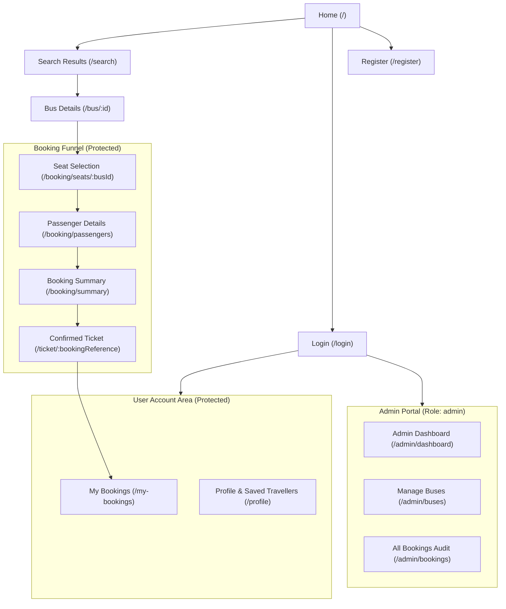

# UI/UX Specification & Design Guidelines

## Bus Booking App — Online Bus Ticket Booking System

| Document Version | Status | Primary Framework | Target Screen Sizes |
| :--- | :--- | :--- | :--- |
| 1.0.0 | Ready for Implementation | Bootstrap 5.3 + Custom CSS | Mobile (<576px), Tablet (576–991px), Desktop (≥992px) |

---

## 1. Design Principles

1. **Simplicity First**: Clear visual hierarchy allowing first-time student and family travellers to find routes and book seats with zero confusion.
2. **Instant Feedback**: Explicit UI feedback for every user touchpoint (button loaders, live price counters, clear validation alerts).
3. **Deterministic Seat State**: Absolute clarity in the seat selection matrix: passengers must never doubt whether a seat is available, selected, or already taken.
4. **Mobile Responsiveness**: Bus tickets are frequently booked on smartphones on the move; mobile views receive the same visual polish as desktop layouts.
5. **Accessibility (a11y)**: High contrast, readable typography, and keyboard accessibility ensuring inclusive usability.

---

## 2. Design System: Color Palette, Typography & Spacing

### 2.1 Color Palette

| Color Role | Hex Code | Bootstrap Utility Class | Usage Context |
| :--- | :--- | :--- | :--- |
| **Primary Brand** | `#0d6efd` | `bg-primary`, `text-primary` | Main CTA buttons, active tabs, navbar brand highlight. |
| **Primary Dark** | `#0a58ca` | `btn-primary:hover` | Button hover and active states. |
| **Available Seat** | `#ffffff` | `bg-white border-secondary` | Available unselected seats on the bus map. |
| **Selected Seat** | `#198754` | `bg-success`, `text-white` | Seats currently picked by the user. |
| **Booked Seat** | `#6c757d` | `bg-secondary text-light` | Seats already occupied by other passengers (disabled). |
| **Background Light** | `#f8f9fa` | `bg-light` | Page background, cards, and modal backdrops. |
| **Dark Slate (Text)**| `#212529` | `text-dark` | Primary typography and headings. |
| **Muted Text** | `#6c757d` | `text-muted` | Subheadings, timestamps, secondary labels. |
| **Danger / Alert** | `#dc3545` | `bg-danger`, `text-danger` | Form error states, collision alerts, delete actions. |
| **Warning / Notice** | `#ffc107` | `bg-warning text-dark` | Post-MVP notices, seat limit warnings. |

### 2.2 Typography
- **Primary Font Family**: System Font Stack / Inter (`system-ui, -apple-system, "Segoe UI", Roboto, "Helvetica Neue", Arial, sans-serif`)
- **Scale**:
  - `Display / H1`: 2.25rem (36px) bold — Hero banner headline.
  - `H2`: 1.75rem (28px) semi-bold — Section and page titles.
  - `H3`: 1.25rem (20px) medium — Card titles, bus names.
  - `Body`: 1rem (16px) regular — Form controls, descriptive text.
  - `Small / Badge`: 0.85rem (13.6px) medium — Seat labels, tags, PNR references.

### 2.3 Spacing & Layout
Standard Bootstrap 5 spacing scale (`$spacer = 1rem`):
- `p-1` (0.25rem), `p-2` (0.5rem), `p-3` (1rem), `p-4` (1.5rem), `p-5` (3rem)
- Maximum container width on desktop: `1200px` (`container`).

---

## 3. Application Sitemap



---

## 4. Reusable Component Catalog

| Component Name | File Path | Props & Description |
| :--- | :--- | :--- |
| **Navbar** | `components/Navbar.jsx` | Fixed-top navigation. Shows search, brand logo, conditional links based on auth role (`Guest`: Login/Register; `User`: My Bookings, Profile, Logout; `Admin`: Admin Dashboard, Manage Buses, Logout). |
| **Footer** | `components/Footer.jsx` | Academic project credits, quick navigation links, GitHub repository link. |
| **BusCard** | `components/BusCard.jsx` | Props: `bus`, `journeyDate`. Renders operator name, type badge, timings, duration arrow, fare, and "Select Seats" action button. |
| **SeatMap** | `components/SeatMap.jsx` | Props: `totalSeats`, `bookedSeats`, `selectedSeats`, `onToggleSeat`. Renders interactive 2x2 grid layout with driver icon and visual legend. |
| **TravellerCard** | `components/TravellerCard.jsx`| Props: `traveller`, `onDelete`, `onSelect`. Card displaying saved passenger name, age, gender with quick-apply and delete actions. |
| **AlertBanner** | `components/AlertBanner.jsx` | Props: `type` (`success`, `danger`, `warning`), `message`, `onClose`. Dismissible alert. |
| **LoadingSpinner** | `components/LoadingSpinner.jsx`| Props: `text`. Full-card or inline centered Bootstrap spinner for async operations. |
| **ProtectedRoute** | `components/ProtectedRoute.jsx`| React Router wrapper redirecting guests to `/login` if unauthenticated. |
| **AdminRoute** | `components/AdminRoute.jsx` | React Router wrapper restricting access to users with `role: 'admin'`. |

---

## 5. Seat Map Specification & Interaction Rules

The interactive seat map is the focal UX element of the application. It mimics a standard 36-to-40-passenger luxury coach.

### 5.1 Physical Layout
- **Column Configuration**: Standard `2 x 2` layout (Window Left, Aisle Left, Center Walkway, Aisle Right, Window Right).
- **Steering Wheel Indicator**: Prominently displayed at the front right to orient the passenger to the bus direction.
- **Rows**: Rows labeled alphabetically (`A` through `I` or `J`), seats numbered 1–4 per row (e.g. `A1`, `A2`, `A3`, `A4`).

### 5.2 Seat States & Visual Styling

| State | Visual Appearance | Styling Details | User Action |
| :--- | :--- | :--- | :--- |
| **Available** | White background, gray outline | `bg-white border border-secondary text-dark` | Clickable. Toggles to "Selected". |
| **Selected** | Solid Emerald Green | `bg-success text-white shadow-sm` | Clickable. Toggles back to "Available". |
| **Booked / Occupied** | Disabled Slate Gray | `bg-secondary text-light opacity-50 cursor-not-allowed` | Unclickable. Shows cursor `not-allowed`. |

### 5.3 Interaction Rules:
1. **Selection Limit**: A user can select a minimum of 1 seat and a maximum of **6 seats** per transaction.
2. **Cap Warning**: If a user attempts to click a 7th available seat, a warning toast appears: *"You can select up to 6 seats per booking."*
3. **Live Fare Counter**: As seats are toggled, a sticky footer bar immediately updates: `Selected: A1, A2 (2 Seats) | Total: ₹1,900`.
4. **Collision Handling**: If another user books a selected seat before checkout submission, the seat map refreshes and displays that seat in the "Booked" gray state with an alert.

---

## 6. Screen-by-Screen Specifications

---

### 6.1 Home Screen (`/`)
- **Route**: `/`
- **Access Level**: Public (Guest, User, Admin)
- **Primary Objective**: Allow users to immediately search for buses.
- **Key Layout Sections**:
  1. **Navbar**: Brand logo and navigation.
  2. **Hero Banner**: High-impact background with headline: *"Find & Book Your Bus Tickets in Minutes"*.
  3. **Search Card**: Centered floating card with:
     - Origin input dropdown (e.g., Kolkata, Mumbai, Bangalore, Delhi).
     - Destination input dropdown (e.g., Siliguri, Pune, Chennai, Jaipur).
     - Journey Date picker (`<input type="date">` with `min={today}`).
     - Primary button: `Search Buses 🚌`.
  4. **Value Highlights / Features**: 3 columns (Safe & Verified Buses, Real-Time Seat Selection, Instant Digital Confirmation).
- **Component States**:
  - **Normal**: Form fields ready for entry.
  - **Validation Error**: Red outlines if origin equals destination or date is in the past.

---

### 6.2 Search Results Screen (`/search`)
- **Route**: `/search?origin=:origin&destination=:destination&date=:date`
- **Access Level**: Public
- **Primary Objective**: Display available buses matching query with key schedule and pricing information.
- **Key Layout Sections**:
  1. **Search Query Ribbon**: Shows searched route and date with a "Modify Search" button.
  2. **Results List**: Vertical stack of `BusCard` components showing:
     - Bus Operator Name & Registration Number
     - Bus Type badge (`AC Sleeper`, `Seater`, etc.)
     - Departure Time, Arrival Time, Duration arrow
     - Fare per seat (`₹950`)
     - Button: `Select Seats ➔`
- **Component States**:
  - **Loading**: Centered spinner with message *"Finding available buses..."*.
  - **Empty**: Card with message *"No buses found operating between [Origin] and [Destination] on this date. Try another date or route."*
  - **Error**: Alert banner with retry button.

---

### 6.3 Bus Details Screen (`/bus/:id`)
- **Route**: `/bus/:id`
- **Access Level**: Public
- **Primary Objective**: Provide deep dive into bus amenities, policies, and boarding points before booking.
- **Key Layout Sections**:
  - Operator Profile and safety ratings.
  - Full Amenities Grid with icons (WiFi, Charging Socket, Reading Light, Water Bottle, Blanket).
  - Terms & Cancellation Policy notice.
  - Sticky button: `Proceed to Seat Selection`.

---

### 6.4 Login Screen (`/login`)
- **Route**: `/login`
- **Access Level**: Public (Redirects to `/` if already authenticated)
- **Primary Objective**: User authentication.
- **Layout**: Centered card (max-width `450px`).
  - Email field (`<input type="email">`).
  - Password field (`<input type="password">`).
  - Primary button: `Log In`.
  - Link to `/register`: *"Don't have an account? Sign up here."*
- **Validation Messages**:
  - *"Please enter a valid email address"*
  - *"Password must be at least 6 characters"*
- **Error State**: Red alert banner: *"Invalid email or password"*.

---

### 6.5 Register Screen (`/register`)
- **Route**: `/register`
- **Access Level**: Public
- **Primary Objective**: Passenger account registration.
- **Layout**: Centered card (max-width `500px`).
  - Full Name, Email, Password, 10-Digit Mobile Phone.
  - Primary button: `Create Account`.
  - Link to `/login`.
- **Validation Messages**:
  - Phone: *"Phone number must be exactly 10 digits"*.
  - Email: *"Please enter a valid email address"*.
  - Password: *"Password must contain at least 6 characters"*.

---

### 6.6 Seat Selection Screen (`/booking/seats/:busId`)
- **Route**: `/booking/seats/:busId?date=YYYY-MM-DD`
- **Access Level**: Authenticated (`user` or `admin`). Guests redirected to `/login`.
- **Primary Objective**: Visual seat map interaction.
- **Layout**: 2-column layout on desktop:
  - **Left Column**: Bus metadata card + Interactive `SeatMap` with driver wheel and legend.
  - **Right Column (Sticky Summary)**:
    - Selected seats chips (e.g. `[Seat A1 ✕] [Seat A2 ✕]`).
    - Price breakdown: `₹950 × 2 = ₹1,900`.
    - CTA button: `Continue to Passenger Details ➔` (disabled if 0 seats selected).

---

### 6.7 Passenger Details Screen (`/booking/passengers`)
- **Route**: `/booking/passengers`
- **Access Level**: Authenticated
- **Primary Objective**: Capture passenger names, ages, and genders for each chosen seat.
- **Layout**:
  - Dynamically renders one form card per selected seat:
    - Heading: `Passenger 1 (Seat A1)`
    - Name field, Age field, Gender dropdown (`Male`, `Female`, `Other`).
    - Button: `Autofill from Saved Travellers` (opens dropdown of user's saved travellers).
  - Checkbox: `Save this passenger to my Saved Travellers list for future bookings`.
  - CTA button: `Proceed to Booking Summary`.

---

### 6.8 Booking Summary Screen (`/booking/summary`)
- **Route**: `/booking/summary`
- **Access Level**: Authenticated
- **Primary Objective**: Final review before transaction commitment.
- **Layout**:
  - Card 1: Route & Timetable (Origin ➔ Destination, Date, Departure, Arrival).
  - Card 2: Passenger Manifest (Table of Seat #, Name, Age, Gender).
  - Card 3: Fare Calculation Breakdown (Base Fare, Taxes, Total Payable).
  - Primary button: `Confirm Booking 🎟️` (triggers atomic booking creation).
- **Concurrency Conflict State**: Red alert banner: *"Seat A1 was just reserved by another customer. Please return to seat selection."*

---

### 6.9 Ticket Screen (`/ticket/:bookingReference`)
- **Route**: `/ticket/:bookingReference`
- **Access Level**: Authenticated
- **Primary Objective**: Official digital proof of travel with PNR.
- **Layout**: Clean ticket stub design with dashed perforated border styling:
  - Top: Green success badge: `BOOKING CONFIRMED`.
  - PNR code: Large bold text (e.g., `BK-98F42A7C`).
  - Journey details, bus operator, departure time.
  - Passenger and seat roster.
  - Action buttons: `Print Ticket` *(Post-MVP)*, `Go to My Bookings`.

---

### 6.10 My Bookings Screen (`/my-bookings`)
- **Route**: `/my-bookings`
- **Access Level**: Authenticated
- **Primary Objective**: Historical log of all user reservations.
- **Layout**:
  - List of booking summary cards arranged newest first.
  - Each card shows: Journey Date, Bus Name, Origin ➔ Destination, Allocated Seats, Total Fare, Status badge (`Confirmed`).
  - Button: `View Full Ticket`.
- **Empty State**: Illustration with text: *"You haven't made any bookings yet. Search for a bus to start your journey!"* with a button to `/`.

---

### 6.11 Profile & Saved Travellers Screen (`/profile`)
- **Route**: `/profile`
- **Access Level**: Authenticated
- **Primary Objective**: Account details and managing frequent traveller profiles.
- **Layout**: Two tabs:
  - **Tab 1 (Personal Info)**: Name, Email, Phone.
  - **Tab 2 (Saved Travellers)**:
    - List of `TravellerCard` widgets with delete buttons.
    - Form to add new traveller (Name, Age, Gender).

---

### 6.12 Admin Dashboard Screen (`/admin/dashboard`)
- **Route**: `/admin/dashboard`
- **Access Level**: Admin Only (`role: 'admin'`)
- **Primary Objective**: Central administrative hub.
- **Layout**:
  - Welcome banner with Admin role badge.
  - Quick Action cards:
    - **Manage Fleet**: Link to `/admin/buses` (Add, edit, remove buses).
    - **View Bookings**: Link to `/admin/bookings` (Audit passenger tickets).
  - Post-MVP KPI Cards (Total Fleet Size, Active Routes, Today's Bookings).

---

### 6.13 Admin Manage Buses Screen (`/admin/buses`)
- **Route**: `/admin/buses`
- **Access Level**: Admin Only
- **Primary Objective**: Full CRUD over bus routes and schedules.
- **Layout**:
  - Header with `+ Add New Bus` button (opens modal form).
  - Responsive table listing: Bus Number, Name, Type, Route, Timings, Fare, Total Seats, Status (`Active` / `Inactive`), Actions (`Edit`, `Delete`).
- **Modal Form (Add / Edit)**:
  - Inputs for Bus Number, Name, Type dropdown, Origin, Destination, Departure Time (`HH:mm`), Arrival Time (`HH:mm`), Duration, Fare, Total Seats.

---

### 6.14 Admin All Bookings Screen (`/admin/bookings`)
- **Route**: `/admin/bookings`
- **Access Level**: Admin Only
- **Primary Objective**: Audit log of all tickets across the platform.
- **Layout**:
  - Date filter input to inspect bookings for a specific departure date.
  - Table showing: Booking Ref (PNR), Customer Name, Customer Phone, Bus Number, Journey Date, Seats Allocated, Fare, Booking Date.
  - Pagination bar (`Previous`, `Page 1 of 5`, `Next`).

---

## 7. Responsive Breakpoint Guidelines

| Device Class | Breakpoint Range | Layout Adjustments |
| :--- | :--- | :--- |
| **Mobile** | `< 576px` | 1-column stacked layout. Seat map centered with touch-friendly 44px seat targets. Sticky bottom bar for seat count and checkout button. |
| **Tablet** | `576px – 991px` | 2-column search cards. Tables scroll horizontally (`table-responsive`). Compact navigation hamburger menu. |
| **Desktop** | `≥ 992px` | Full multi-column layout. Sticky sidebar for seat selection checkout summary. Comprehensive admin data tables. |

---

## 8. ASCII Wireframes for Key Screens

### 8.1 Home Screen Wireframe
```text
+-----------------------------------------------------------------------+
|  [LOGO] 🚌 Bus Booking App             Home   Search   [Login] [Register]|
+-----------------------------------------------------------------------+
|                                                                       |
|             FIND & BOOK YOUR BUS TICKETS IN MINUTES                   |
|                                                                       |
|   +---------------------------------------------------------------+   |
|   |  FROM: [ Kolkata        v ]   TO: [ Siliguri          v ]     |   |
|   |                                                               |   |
|   |  DATE: [ 2026-11-20     📅 ]   [ 🚌 SEARCH BUSES            ] |   |
|   +---------------------------------------------------------------+   |
|                                                                       |
|   [ 🛡️ Safe Journeys ]    [ 💺 Live Seat Choice ]   [ 🎫 Instant PNR ] |
+-----------------------------------------------------------------------+
|  (C) 2026 Bus Booking App Team | Academic College Project             |
+-----------------------------------------------------------------------+
```

### 8.2 Search Results Screen Wireframe
```text
+-----------------------------------------------------------------------+
|  [LOGO] 🚌 Bus Booking App             Home   My Bookings   [Profile v] |
+-----------------------------------------------------------------------+
|  Route: Kolkata -> Siliguri  |  Date: 20-Nov-2026   [ Modify Search ] |
|-----------------------------------------------------------------------|
|  +-----------------------------------------------------------------+  |
|  | Greenline Express (WB-04-E-5678)            [ AC Sleeper Badge ]|  |
|  | Departure: 20:00 (Kolkata)  ---- 10h 00m ---->  06:00 (Siliguri)|  |
|  | Fare: ₹950 per seat      Amenities: WiFi, Water, Blanket        |  |
|  |                                                [ SELECT SEATS ➔]|  |
|  +-----------------------------------------------------------------+  |
|                                                                       |
|  +-----------------------------------------------------------------+  |
|  | Royal Cruiser (WB-02-B-1122)                     [ Seater Badge]|  |
|  | Departure: 21:30 (Kolkata)  ---- 11h 00m ---->  08:30 (Siliguri)|  |
|  | Fare: ₹650 per seat      Amenities: Water Bottle                |  |
|  |                                                [ SELECT SEATS ➔]|  |
|  +-----------------------------------------------------------------+  |
+-----------------------------------------------------------------------+
```

### 8.3 Interactive Seat Selection Screen Wireframe
```text
+-----------------------------------------------------------------------+
|  Seat Selection: Greenline Express | Kolkata -> Siliguri (20-Nov-2026) |
+-----------------------------------------------------------------------+
|  [BUS SEAT MAP]                         |  [SELECTED SEATS SUMMARY]   |
|                                         |                             |
|  Front of Bus       [ Steering Wheel 🛞]|  Seats: A1, A2 (2 Selected) |
|  -------------------------------------  |                             |
|  [A1-SEL] [A2-SEL]   |   | [A3-AVL] [A4-AVL]|  Fare Breakdown:            |
|  [B1-BKD] [B2-BKD]   | A | [B3-AVL] [B4-AVL]|  ₹950 x 2 = ₹1,900          |
|  [C1-AVL] [C2-AVL]   | I | [C3-AVL] [C4-AVL]|                             |
|  [D1-AVL] [D2-AVL]   | S | [D3-BKD] [D4-AVL]|  [CONTINUE TO PASSENGERS ➔] |
|  [E1-AVL] [E2-AVL]   | L | [E3-AVL] [E4-AVL]|                             |
|  -------------------------------------  |  Legend:                    |
|                                         |  [ ] Available (White)      |
|                                         |  [*] Selected (Green)       |
|                                         |  [X] Booked (Disabled Gray) |
+-----------------------------------------------------------------------+
```

### 8.4 Confirmed Digital Ticket Screen Wireframe
```text
+-----------------------------------------------------------------------+
|                          TICKET CONFIRMATION                          |
+-----------------------------------------------------------------------+
|  +-----------------------------------------------------------------+  |
|  |  STATUS: CONFIRMED 🟢                       PNR: BK-98F42A7C    |  |
|  |  -------------------------------------------------------------  |  |
|  |  Bus: Greenline Express (WB-04-E-5678) - AC Sleeper             |  |
|  |  Route: Kolkata  ------------------------>  Siliguri            |  |
|  |  Departure: 20-Nov-2026, 20:00     Arrival: 21-Nov-2026, 06:00  |  |
|  |  -------------------------------------------------------------  |  |
|  |  PASSENGERS & SEATS:                                            |  |
|  |  1. Arjun Sharma   | Age: 30 | Gender: Male   | Seat: A1        |  |
|  |  2. Priya Sharma   | Age: 28 | Gender: Female | Seat: A2        |  |
|  |  -------------------------------------------------------------  |  |
|  |  Total Fare Paid: ₹1,900                                        |  |
|  +-----------------------------------------------------------------+  |
|                                                                       |
|         [ 🖨️ Print Ticket ]          [ 📜 View All My Bookings ]      |
+-----------------------------------------------------------------------+
```
